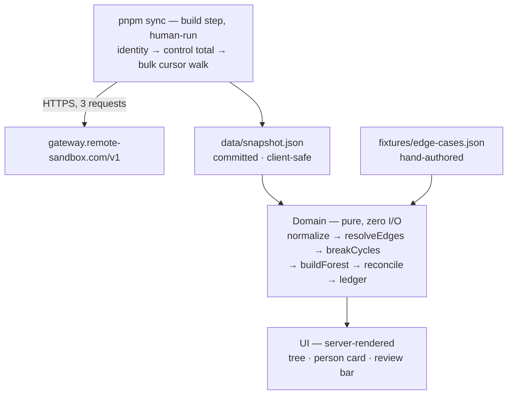

# Org Chart — Build Specification

**System:** Organizational chart for Acme Sandbox Corp
**Data source:** Remote Customer API (sandbox) · `gateway.remote-sandbox.com/v1`
**Budget:** 8 hours of focused work
**Document status:** Authoritative. This is the single specification for what is built, how it behaves, and what it guarantees.

**Scope rule:** every element specified here satisfies a stated requirement, or removes a failure mode that would otherwise be silent *and* costs under thirty minutes to build. Everything that failed that test is listed at the end of this document under **Deliberately out of scope**, with the condition under which it becomes worth building.

---

## System shape

The sync is a **build step**, not a runtime path. A human runs `pnpm sync`; it walks the API once, projects the result to a client-safe model, and writes `data/snapshot.json`. That file is committed and ships in the bundle.



**The deployed application performs no network I/O and holds no credential.** That is the load-bearing decision in this design, and it follows from a property of the data: org structure changes on a scale of weeks, so runtime freshness buys almost nothing here. Making the sync a build step removes, rather than solves, an entire class of problem — concurrent cold-cache syncs, retry amplification against a company-wide rate budget, a bad sync overwriting a good snapshot, and a revoked token scheduling authenticated calls forever.

It also converts the one hard constraint of this exercise into a structural guarantee. **Sandbox access is revoked 14 days after provisioning.** A system that fetches at runtime has to defend against that with a fallback ladder. A system that fetches at build time is simply unaffected: the public URL renders identically on day 40.

Everything that can be wrong about the data — a cycle, a dangling pointer, a manager outside Remote, a malformed record — is decided inside a pure function from `EmploymentRecord[]` to `OrgSnapshot`. That is what makes the guarantees in §F testable rather than asserted.

### Timebox

| Block | Hours | Output |
|---|---|---|
| **H0 · Contract spike** | 0:00–0:45 | `curl` identity, control total, and one bulk page. Confirm the token carries `employment:read`. **Redact each body at capture per §I.1**, then save into `fixtures/captured/`. |
| **H1 · Sync + deploy** | 0:45–2:00 | `RemoteClient`, Zod projection, cursor walk, `pnpm sync` writing `data/snapshot.json`. **A hello-world is deployed to Vercel in this block**, not at the end. |
| **H2 · Domain** | 2:00–3:30 | normalize · resolve-edges · break-cycles · build-forest · reconcile · ledger. Pure. **The README's architecture rationale and out-of-scope table are written here**, while the decisions are being made. |
| **H3 · Tests** | 3:30–4:15 | Edge-case fixture + one test per ledger code + conservation law + determinism. ~15 tests. |
| **H4 · UI** | 4:15–6:15 | Screen topology per §H.3: tree, person card, toolbar, review bar. |
| **H5 · Buffer** | 6:15–7:00 | Reserved. Deployment is already live and needs only a push, so this hour absorbs H4 rather than funding new scope. |
| **H6 · Write-up** | 7:00–8:00 | README completion: setup, verification without a token, assumptions, limitations. |

Two of these placements are deliberate rather than incidental. Deployment sits in H1 because it is the one failure that cannot be recovered at hour 7.5, and with no environment variable to configure it costs ten minutes to remove from the critical path entirely. The README's reasoning sits in H2 because it carries the scope decisions, and the block carrying the scope decisions must not also be the block that absorbs an overrun — which is what the last block always becomes.

---

## A. Users and use cases

Two user classes. The operator's needs define the product; the evaluator's needs define the delivery.

### A.1 First-time evaluator (primary)

An engineer opening the deployed URL with no context, no credentials, and no setup — possibly after the sandbox token has been revoked.

| # | Use case | System obligation |
|---|---|---|
| R1 | Open the public URL cold and see a populated chart | No login, no empty state, no client-side fetch on first paint |
| R2 | Understand the hierarchy without interacting | Tree expanded to depth 2 by default, server-rendered |
| R3 | Inspect how imperfect data is handled | The integrity panel is present on every view inside the review bar (§H.3), and is deep-linkable |
| R4 | Establish whether the data can be trusted | Capture line in the header on every view; the full provenance block, including the walk's own counters, in the review bar |
| R5 | Clone the repo and run it with no `.env` | `pnpm i && pnpm dev` renders the committed snapshot |
| R6 | Exercise the edge-case handling | The review bar's source selector switches the deployed app to the edge-case fixture |

### A.2 Acme People Operator

Owns the workforce data, not the integration. Every feature traces to one of these.

| # | Use case | System obligation |
|---|---|---|
| P1 | "Who reports to whom across the company?" | Tree with direct-report counts and collapse/expand |
| P2 | "Who has no manager, and who is unreachable in the hierarchy?" | Integrity panel: `ROOT_NO_MANAGER`, `MGR_DANGLING`, `MGR_EXTERNAL`, and the same finding on the affected person's card |
| P3 | "What exactly do I send HR to fix?" | Every ledger row carries a reason code, a privacy-safe detail, a severity, an owner, and the action that resolves it |
| P4 | "Where does one person sit, and what is their chain to the top?" | Selecting a person renders the full chain to root |
| P5 | "Is this chart complete?" | Conservation counter and count reconciliation, displayed on screen |

---

## B. Functional requirements

Every requirement is a testable statement. `Brief` denotes a requirement stated in the engagement brief; `Added` denotes an engineering addition that satisfies the scope rule.

| ID | Requirement | Acceptance test | Source |
|---|---|---|---|
| **F1** | `pnpm sync` walks company identity, a control total, and all employments into one normalized, client-safe snapshot | Bulk walk reaches `next_cursor === null` with no repeated cursor and no duplicate employment ID; `listTotalCount === recordCount − deletedCount`; total requests equal `2 + ceil(N/100)` | Brief |
| **F2** | Build a reporting **forest** from the employment set, recording how each edge was determined | Unit tests over fixtures for: multi-root, cycle, self-manager, dangling pointer, external manager, duplicate name. Every `ReportingEdge` carries a `basis` | Brief |
| **F3** | Render a collapsible hierarchical tree as the primary visualization, expanded to depth 2 | Every node card shows name, job title, department, and direct-report count. Fully operable by keyboard with `role="tree"` semantics | Brief |
| **F4** | Show a person's full reporting line to the root | Selecting a person renders `CEO → VP → Director → person`; the selection is reflected in the URL as `?person=<employmentId>` and restores on paste | Brief |
| **F5** | Handle missing data and structural anomalies gracefully and **visibly** | No record is silently dropped: `recordCount === nodesPlaced + recordsQuarantined`, asserted in a unit test. The claim it supports — *all accounted for* — is in the toolbar on every view, with the arithmetic one disclosure click behind it in the same component | Brief |
| **F6** | **Integrity panel** — every exception with a reason code, a privacy-safe detail, a severity, an owner, and the action that resolves it | One row per `DataIssue`, stating what to do and who does it, grouped by `scope` so record findings and sync findings are never mixed. Record-scoped findings additionally render on the affected person's card | Added |
| **F7** | Provenance on every view | The header carries the capture line in plain language and the viewer's locale, with relative age alongside. The full block — `apiCallCount`, `pageCount`, `terminalCursorReached`, `countReconciled`, `contentHash` — renders in the review bar. Correct for both sources | Added |
| **F8** | Runs with zero credentials, and the edge-case dataset is selectable **on the deployed system** | `git clone && pnpm i && pnpm dev` with no `.env` renders the full chart. The review bar's source selector switches between the committed snapshot and the fixture, and the selection is reflected in the URL | Added |
| **F9** | Filter the tree by name, job title, or department | Typing a query narrows the tree to matching nodes and their ancestors, with ancestors marked as context rather than as matches. Selecting a department — including the Unassigned bucket — narrows it the same way, and the two compose. Both are reflected in the URL | Added |

**On F8.** The two capabilities are one mechanism serving two guarantees. *Zero-credential operation* means anyone holding the repository can run and modify the system with no access to Remote — a property of the handover, not a convenience. *A selectable fixture on the deployed system* means the edge-case handling in §F is demonstrable regardless of what the real dataset happens to contain: data quality is a property of the source, and a clean dataset must not make the handling of a dirty one unobservable. The fixture is the same dataset the test suite runs against, so what is demonstrated in the UI is exactly what is asserted in CI.

---

## C. Non-functional requirements

Each target is falsifiable and each has one named mechanism.

| # | Attribute | Target | Mechanism |
|---|---|---|---|
| 1 | **Speed** | First paint carries the complete chart. Zero API round trips at request time. Expand, filter, and select respond within one frame at company scale | The snapshot is a static import. Server components render from it directly, so there is no partial-load state to design, render, or test. `O(n)` normalization, edge resolution, and forest construction; derived metrics computed once during `buildForest` |
| 2 | **Accessibility** | WCAG 2.1 AA contrast in both themes; the tree is fully keyboard-operable; the ledger is a real `<table>` | `role="tree"` / `treeitem` / `group` with arrow-key navigation and roving tabindex; visible focus rings. Verified by a manual axe pass and a full keyboard traversal |
| 3 | **Security** | No API token exists anywhere in the deployed system | The token is read by the sync script only, from the local environment, and never by application code. The deployed host has no Remote credential to leak, log, or spend. `.env.example` only; `.env*` git-ignored |
| 4 | **Privacy** | The committed artifact contains only the fields required to render an org chart | The projection in §D.2 **never reads an email field**. No email, address, compensation, contract, or raw Remote payload enters the snapshot, the ledger, a log, or a committed fixture (§I.1) — the claim holds across the whole repository, not only across what the system generates. `X-Robots-Tag: noindex` — synthetic or not, employee-shaped data should not be indexed |
| 5 | **Correctness** | Every record is schema-validated; pagination is provably complete; no silent partial load; every graph anomaly is surfaced | Zod per record over the narrow projection; terminal-cursor and uniqueness guards; cross-endpoint count reconciliation (§G.2); the conservation law |
| 6 | **Maintainability** | A stranger changes the manager-resolution rule by editing one file, and a failing test tells them if they broke it | Hard module boundary (§H.2), enforced by lint rule. Strict TypeScript; no `any`, no non-null assertion on API data. `domain/` imports nothing from `next`, `react`, or the client, so it serves another org-chart source by writing one adapter. Comments state invariants; they never restate the code |
| 7 | **UI/UX** | Clear visual hierarchy, legible at 360px, correct in light and dark, no layout shift on expand | Tailwind design tokens; CSS-grid indentation with connector rails drawn as borders (§H.3); any measurement stays inside the tree component and may not produce shift on expand; transitions on transform and opacity only |
| 8 | **Testability** | Every guarantee in §F has a named test; the suite runs with no network and no credential | Vitest over committed fixtures. One test per ledger code, plus the conservation law, the `country` projection shape, and a determinism assertion (§G.3) |

---

## D. Entities and relationships

Two layers held strictly apart: what the API returns, and what the domain derives. No UI component ever touches a raw Remote shape.

### D.1 Source entities, as returned

| Entity | Key fields | Cardinality |
|---|---|---|
| **Company** | `id`, `name` — from `/v1/identity/current` | 1 → N Employment |
| **Employment** | `id` (UUID, the person key), `short_id`, `company_id`, `full_name`, `job_title?`, `department?`, `department_id?`, `country?` *(an object — see §E.4)*, `type`, `status`, `user_status?`, `employment_lifecycle_stage`, `updated_at?`, `manager` (name string), `manager_employment_id?` | N → **0..1** Employment, self-referential via `manager_employment_id` |

**The cardinality is the central design constraint.** An employment has at most one manager. Matrix reporting, dotted lines, and co-managers are not expressible in Remote's employment model, so they are not in this system's model either. True matrix hierarchy lives in `company-structure-nodes`, a separate dimension that is out of scope (§E.3).

### D.2 Staging projection

The sync script parses and retains **only** these fields from each bulk record. Everything else in the Employment payload is discarded at the boundary, before anything is written to disk:

`id` · `short_id` · `company_id` · `full_name` · `job_title` · `department` · `department_id` · `country.name` · `country.alpha_2_code` · `type` · `status` · `user_status` · `employment_lifecycle_stage` · `manager` · `manager_employment_id` · `updated_at`

**No email field is read at all** — not `work_email`, not `login_email`, not `manager_email`, not `personal_email`. This is stronger than reading emails and stripping them later, and it is possible because the edge ladder in §D.6 resolves managers by ID or by name, never by email address (see the note on email inference under **Deliberately out of scope**).

Parsing happens in **two stages**. A minimal pre-pass reads `id` and `status` only — two fields whose absence would mean the response is not an employment list at all — and every walked record passes through it. The full projection is then validated per record; a failure quarantines that record as `RECORD_INVALID`.

The pre-pass is not decoration: a quarantined record must still be **counted** and still be **classifiable as deleted**, or the count reconciliation in §G.2 would render a green check while being false.

A record that fails **the pre-pass itself** has no readable identity, and the invariant has to say what becomes of it rather than argue that it cannot happen. It is counted in `recordCount` and quarantined as `RECORD_INVALID` with a null `employmentId` and a positional detail — `page 2, record 17` — so the conservation law stays total and the walk continues, consistent with the rule that one malformed record never blanks the chart. It cannot be classified as deleted, so a nonzero pre-pass failure count is itself the explanation for any `COUNT_MISMATCH` raised alongside it, and both findings appear in the same ledger for a reader to connect.

### D.3 Derived entities

| Type | Purpose |
|---|---|
| `Person` | Flattened, null-safe view of one employment. The only person shape the UI knows |
| `ExternalManager` | A manager named on a record but not managed through Remote. Synthetic, namespaced, rendered in the tree, excluded from the conservation law |
| `UnresolvedManager` | A placeholder standing in for a `manager_employment_id` that points outside the fetched set. One per distinct missing ID |
| `ReportingEdge` | Makes *how* a reporting line was determined a first-class inspectable fact rather than an implementation detail |
| `DataIssue` | One row of the exception ledger. The Integrity panel and the audit record are the same object |
| `OrgNode` | Everything the tree and the breadcrumb need, precomputed once during forest construction |
| `Forest` | A forest, not a tree. Multiple roots are the normal case, not an error |
| `Provenance` | Answers "where did this number come from, and when" without asking the author |

### D.4 The model

```ts
/** The complete client-safe payload. Everything rendered comes from this object. */
type OrgSnapshot = {
  schemaVersion: 1;
  company: { id: string; name: string };
  people: Person[];
  externalManagers: ExternalManager[];
  unresolvedManagers: UnresolvedManager[];
  edges: ReportingEdge[];
  issues: DataIssue[];
  provenance: Provenance;
};

type Person = {
  employmentId: string;        // authoritative person key for this integration
  shortId: string | null;      // display disambiguation only — never a join key
  name: string;
  jobTitle: string | null;
  department: { id: string | null; name: string | null };
  country: { name: string | null; code: string | null };  // exactly two leaves of NullableCountry
  employmentType: string;      // passthrough union — see §E.4
  employmentStatus: string;    // open vocabulary by design — see §E.4
  userStatus: string | null;
  lifecycleStage: string;
  updatedAt: string | null;
};

/**
 * Which nulls a People Operator must act on, and which are merely absent (§F.2).
 * A critical null renders a `Missing` marker naming its owner; everything else
 * renders an em-dash. Absence of a manager is structural and is carried by
 * ROOT_NO_MANAGER instead.
 */
const CRITICAL_FIELDS = ['jobTitle', 'department'] as const;

/**
 * A manager named on an employment who is not themselves managed through Remote.
 * Synthetic: no employment, no Remote identity, never counted by the conservation law.
 */
type ExternalManager = {
  id: string;                  // `external:<slug>` — namespaced, cannot collide with a UUID
  displayName: string;         // from Employment.manager, the only field trusted here
};

/** Stands in for a manager ID that resolves to nothing. Reports attach here rather than vanish. */
type UnresolvedManager = {
  id: string;                  // `unresolved:<managerEmploymentId>`
  missingManagerId: string;
};

type ReportingEdge = {
  reportEmploymentId: string;
  parentId: string | null;     // an employmentId, an `external:` id, or an `unresolved:` id
  basis: 'manager_employment_id' | 'external_name' | 'unresolved' | 'cycle_broken' | 'none';
  // 'cycle_broken' is a parentless edge that *had* a parent until §D.6 rule 3 cut it.
  // 'none' means the record never named a manager. Collapsing the two would make
  // `basis` false on exactly the edges a reader most needs to distinguish.
};

type DataIssue = {
  code: IssueCode;             // the closed set in §F.1
  scope: 'record' | 'sync';    // a finding about one employment, or about the walk as a whole.
                               // Decides where it may render (§H.3) — `employmentId === null`
                               // cannot, because a pre-pass failure carries a null ID too (§D.2)
  severity: 'info' | 'low' | 'medium' | 'high';
  employmentId: string | null;
  displayName: string | null;
  safeDetail: string;          // no email, no token, no raw Remote payload
  suggestedOwner: 'Acme People Ops' | 'Integration owner';
  suggestedAction: string;     // the fix, not the fault — templated per code in ledger.ts
};

type Provenance = {
  source: 'remote_sandbox' | 'synthetic_fixture';
  environment: 'sandbox';
  capturedAt: string;                  // ISO 8601
  companyId: string;
  pageCount: number;
  recordCount: number;                 // employments walked, counted at the pre-pass
  quarantinedCount: number;            // of those, failed the full projection -> RECORD_INVALID
  deletedCount: number;                // of those, status === 'deleted', read at the pre-pass
  listTotalCount: number | null;       // control total from /v1/employments
  countReconciled: boolean;            // listTotalCount === recordCount - deletedCount
  terminalCursorReached: boolean;
  contentHash: string;
  apiCallCount: number;
};

/** Derived once during buildForest; never recomputed per render. */
type OrgNode = {
  id: string;
  kind: 'person' | 'external' | 'unresolved';
  person: Person | null;       // null for synthetic nodes
  displayName: string;
  children: OrgNode[];
  depth: number;
  pathToRoot: string[];        // ancestor ids, nearest first
  directReports: number;
  totalDescendants: number;
};

type Forest = {
  roots: OrgNode[];
  byId: Map<string, OrgNode>;
  maxDepth: number;            // consumed by the toolbar summary line (§H.3) — a derived
                               // field with no reader is a field that should not exist
};
```

### D.5 The two sources

| Source | Selector value | Header copy | Role |
|---|---|---|---|
| **Committed snapshot** | `?source=snapshot` (default) | `Acme Sandbox Corp · Data captured 21 Aug, 2:14 PM · yesterday` | The real organization. Written by `pnpm sync`, committed, ships in the bundle |
| **Edge-case fixture** | `?source=fixture` | `Demo data — synthetic fixture, not Acme's organization` | The zero-credential run path, every unit test, and the demonstration surface for §F |

The fixture is **selected, never fallen back to**. Synthetic records must never be served as though they were Acme's organization — the one case where usability and integrity genuinely conflict, and integrity wins. If `data/snapshot.json` is absent or unparseable, the system renders the empty state of §F.2 naming the cause, not the fixture.

**When the fixture is selected it is unmistakable, including out of context.** The page carries a full-width amber band with the persistent text *Demo data — synthetic fixture, not Acme's organization*, and the document title changes to match so a browser-tab screenshot is unambiguous too. Colour alone would fail WCAG SC 1.4.1 at Level A, and a screenshot circulating without its page is the realistic way synthetic data gets mistaken for real.

The header reports what the data **is**, and always renders age relatively with the absolute time alongside, so a reader never has to subtract dates to learn how stale the chart is.

### D.6 Edge resolution — the rule that determines the graph

Resolve each employment's parent by descending this ladder, stopping at the first hit. Record the basis on the edge. **An inference is never silently promoted to a fact.**

| # | Condition | Result | `basis` | Ledger |
|---|---|---|---|---|
| 1 | `manager_employment_id` present and resolves within the fetched set | Authoritative edge | `manager_employment_id` | — |
| 2 | `manager_employment_id` present but resolves to nothing | Person retained, attached to an `UnresolvedManager` placeholder root — one per distinct missing ID | `unresolved` | `MGR_DANGLING` |
| 3 | No manager ID, but `manager` names someone | Synthetic `ExternalManager` node, **rendered in the tree**, visually distinct | `external_name` | `MGR_EXTERNAL` |
| 4 | No manager information at all | Legitimate root | `none` | `ROOT_NO_MANAGER` (info) |

Four rules make this deterministic rather than merely described.

**1 · A broken pointer outranks a name, and never falls through.** Rung 3 requires that no manager ID be present at all. Without that clause, a record with an unresolvable ID *and* a populated manager name — which is nearly every such record — would become an external manager, and `MGR_DANGLING` would never fire for anyone. An ID that points nowhere is evidence of a source-system fault; routing around it with a weaker field would hide the fault while producing an edge that looks authoritative. Rungs 1 and 2 are mutually exclusive with 3 and 4 by the presence of the ID alone, so **every employment carries at most one `MGR_*` code and exactly one edge.**

**2 · External managers merge on name, and the merge is order-independent.** The slug is a pure function of the manager name — trim, Unicode NFC, lowercase, collapse internal whitespace — so six employments naming the same manager produce **one** node with six children regardless of arrival order. IDs are namespaced `external:<slug>` so a synthetic ID can never collide with an employment UUID.

*Stated limitation:* with no manager email in the projection, two distinct people who share a full name would merge into one external node. This is recorded in the README rather than guessed at — the alternative, keying on a personal identifier, would put an email address into a public artifact to fix a case that a 42-person company almost certainly does not have.

External managers are rendered rather than hidden because Acme wants their organization, not the Remote-managed subset of it. Dropping the line to a manager paid through a different system leaks an integration boundary into the customer's view of their own company. The node renders *and* the ledger reports it; those were never alternatives.

**3 · Cycles are cut by construction, at a node chosen independently of traversal order.** After edges are built, a DFS with colour marking detects self-references and loops of any length, and re-parents the affected member to a root. The forest is acyclic because it was made acyclic, not because the data was trusted.

Which edge gets cut cannot be left to "wherever the back-edge was found," because that depends on where the traversal started. The rule: **iterate nodes in ascending employment-ID order; on detecting a cycle, enumerate its complete member set, then cut the edge whose child holds the lowest employment ID in that set.** Enumerate first, then choose. The same loop in any input order yields the same cut, the same root, and the same ledger entry.

**A cut edge records that it was cut.** `parentId` becomes null and `basis` becomes `cycle_broken` — never `none`. This is not bookkeeping: a record that named no manager and a record whose manager was deliberately discarded are different facts about the source data, and only the first is `ROOT_NO_MANAGER`. Collapsing them would let a broken loop render as an ordinary second root — indistinguishable from a genuine head of the company in the tree, on the card, and in principal-root selection (§H.3) — while the ledger quietly held the contradiction.

**4 · The conservation law.**

> `recordCount === nodesPlaced + recordsQuarantined`

Every walked record has exactly one home — the chart or the quarantine. Nothing is dropped to make the picture tidy.

`recordsQuarantined` counts `RECORD_INVALID` only. Four of the remaining codes are annotations on records that *were* placed — a `ROOT_NO_MANAGER` person is in the tree, and counting them as exceptions would turn the invariant red on healthy data. `COUNT_MISMATCH` is neither placed nor excepted: it is a finding about the walk rather than about any employment, which is what `DataIssue.scope` exists to distinguish. That distinction is load-bearing in the UI as well as in the arithmetic — a sync-scoped finding must never appear on a person card, and `employmentId === null` cannot decide it, because a pre-pass failure carries a null ID too (§D.2). **Both synthetic node kinds are excluded from both sides:** external managers and unresolved-manager placeholders were never fetched, so they can be neither placed nor quarantined. Fixtures for both are authored before the resolver, so the invariant is exercised against them from the first test run.

---

## E. APIs

### E.1 The read path

| Order | Call | Supplies | Cost |
|---|---|---|---|
| 1 | `GET /v1/identity/current` | Company `id` and `name`, and a token smoke test | 1 |
| 2 | `GET /v1/employments?page=1&page_size=1` | `total_count` — the independent control total | 1 |
| 3 | `GET /v1/employments/bulk?company_id={id}&limit=100` | Full employment records including manager linkage | `ceil(N/100)` |

**Budget: `2 + ceil(N/100)`.** Remote's first-call documentation shows a demo company at `total_count: 42`, so a company of that size syncs in three requests — roughly 1% of the per-minute company budget, spent a handful of times over the life of the project rather than continuously.

Call 2 is ordered deliberately **before** the bulk walk. It costs one request, returns a single record, and means that if the walk later fails mid-cursor, the operator still knows how many employments the company was supposed to have.

Company ID is read from `/v1/identity/current` rather than maintained as a second hand-copied constant, and sent explicitly on bulk — where it is optional — so requests are self-documenting in logs and stay correct if the token's scope is widened.

### E.2 The observation that determines the read path

Remote's guide *Sync your workforce data efficiently* recommends `GET /v1/employments` for the initial load, and in the same document warns against the per-employee detail loop, citing a customer who reached roughly **8.8 million calls per month** doing exactly that.

`GET /v1/employments` returns a **minimal** employment object carrying `job_title`, `department`, and `department_id` — but **no manager field of any kind**. The recommended path therefore cannot produce an org chart on its own; recovering the reporting edge from it requires precisely the per-employee loop the same guide warns against.

`GET /v1/employments/bulk` resolves this in a single cursor walk: full-detail records, manager linkage included, `ceil(N/100)` calls. It is indexed in Remote's machine-readable documentation as "Bulk list employments," lists both Sandbox and Production servers, and carries no beta, deprecated, or partner-only marker.

**Two consequences for the build.** First, no list-plus-detail fallback is written: a fallback that reproduces a documented anti-pattern is worse than no fallback. Second, the residual risk on bulk is *entitlement*, not documentation status — it requires `employment:read` or an enclosing scope, and the issued token's scope set is not knowable in advance. This is verified at H0 before any code depends on it, distinguishing `403` (valid token, missing scope) from `401` (expired or revoked token).

### E.3 Endpoints evaluated and not used

| Endpoint | Assessment |
|---|---|
| `GET /v1/employments` as a roster | No manager fields at any page size. Its `total_count` is used as the control total; its records are not used |
| `GET /v1/employments/{id}` in a loop | Remote identifies per-employee polling as the expensive anti-pattern. Reserved for single-record refresh under a future webhook (§E.5) |
| `GET /v1/company-departments` | Bulk already carries `department` and `department_id`, which is everything the tree and the filter consume. The canonical list would add only drift detection between free-text and canonical names — a second endpoint, a second scope, and a second failure mode, to report a naming mismatch that changes nothing about the chart |
| `GET /v1/company-managers` | Lists Remote **administrative** users keyed to `user_id`, with values such as `owner`. It is a permissions role, not an employment reporting line. Excluded from graph logic entirely |
| `GET /v1/scim/v2/Users` | Carries manager references and department but no job title; would require a second feed and a cross-resource join |
| `GET /v1/employments/{id}/company-structure-nodes` | Models a distinct hierarchy — cost centre, supervisory org — with `parent` and `attributes`. Per-employment and therefore N+1 |
| Remote MCP | An interactive surface: OAuth-PKCE browser sign-in, acting as the signed-in user and bounded by that user's own permissions. This system is a server-to-server integration authenticating as a Customer API token — a different principal with a different scope set — and Remote's documentation states MCP is not a replacement for the REST API in a deterministic integration. **Excluded entirely.** Nothing here reads from it at runtime or at build time, and the independent cross-check the system does perform is §G.2: same token, different endpoint |

### E.4 Contract characteristics, each with its handling

Every row below is a documented inconsistency or trap found during the API audit. Each costs a line of code and a comment; each would otherwise be found in production.

| Characteristic | Consequence if unhandled | Handling |
|---|---|---|
| `/v1/identity/current` documents its success schema under **HTTP 201**, not 200 | A smoke test asserting `=== 200` reports a false outage on a healthy token | Accept any `2xx` |
| `x-ratelimit-reset` is a **duration in milliseconds**, not a Unix timestamp | Treating it as absolute produces a sleep measured in decades | Parsed as a duration; the unit is asserted in a comment |
| The bulk response carries **no `total_count`** — only `{ data, next_cursor }` | Completeness cannot be verified within the endpoint | Terminal-cursor and uniqueness guards, plus the cross-endpoint control total (§G.2) |
| Bulk accepts **only** `company_id`, `cursor`, `limit` — no status or type filter, though the minimal list endpoint offers all three | Archived and deleted employments arrive unbidden | All visibility filtering happens in the domain layer. This is an API-surface asymmetry, not an implementation shortcut |
| The list endpoint excludes deleted records; bulk does not | A naive `total_count === recordCount` check fails permanently | The invariant subtracts: `listTotalCount === recordCount − deletedCount` |
| `country` is a full object (`NullableCountry`), not a string | Projecting it whole would drag country-specific form schemas into a public artifact and multiply snapshot size | Exactly two leaves — `name` and `alpha_2_code`. A test asserts the projected object carries no other keys. The whole field is nullable, so both leaves are `string \| null` |
| The bulk `status` enum is **wider** than Remote's own employment-statuses guide, adding `pre_hire`, `created_awaiting_reserve`, `created_reserve_paid`, `job_title_review`, `pending_post_self_enrollment_actions`, and `offboarding` | A strict `z.enum()` quarantines healthy records the moment Remote adds a value, inflating `RECORD_INVALID` and turning the Integrity panel into a false-positive generator | `status`, `user_status`, `type`, and `lifecycle_stage` parse as `z.string()` and render as received. Strict validation applies to identifiers only |
| **"Terminated" is not a Remote employment status.** No such value exists in either vocabulary | Filtering on it silently matches nothing | Departure is detected from three signals together: `status ∈ {offboarding, archived, deleted}`, `lifecycle_stage === 'offboarded'`, or `user_status ∈ {inactive, cancelled, deleted}`. `termination_date` exists only on the single-record endpoint and is unavailable to this sync by construction |
| Bulk prose states `files` is always `null`, while the embedded schema declares it a required array | A faithful validator fails every record | The narrow projection ignores `files` entirely |
| `manager_employment_id` is populated only when the manager is also managed through Remote, and is null otherwise. There is no `manager_id` | Assuming the ID is always present drops every externally-managed report | The resolution ladder in §D.6 exists precisely for this |

### E.5 Auth, transport, and production evolution

- **Base URL:** `https://gateway.remote-sandbox.com/v1`. Production is `gateway.remote.com` — fully isolated accounts and tokens.
- **Auth:** Customer API token, `Authorization: Bearer ra_test_…`, read from the local environment **by the sync script only**. The `ra_test_` prefix is asserted at startup, so an `ra_live_` token fails fast with a clear message rather than producing confusing `401`s.
- **Rate limit:** 300 requests per minute **scoped to the company, not the token**, on a rolling 60-second window. Every authenticated response carries `x-ratelimit-count`, `x-ratelimit-remaining`, and `x-ratelimit-reset`; a `429` carries all three.
- **Failure taxonomy:** `401` means expired or revoked. `403` means valid but lacking a scope. Different owners, different fixes — separated in the script's exit message.
- **Sandbox lifetime:** access is revoked 14 days after provisioning. The deployed system is unaffected, because it holds no token and makes no call.

**Production evolution.** Beyond this system the correct freshness mechanism is webhook-driven incremental sync rather than polling. `employment.details.updated` is load-bearing: Remote documents it as firing *"whenever an employment `department` or `manager` is updated"* — precisely the two fields this product renders. `employment.status.updated` and `employment.updated` cover visibility and act as a safety net; contract events carry job-title changes, since title is a versioned contract term. Company-manager and company-structure events are not reporting-line updates and would not be subscribed.

Two delivery semantics belong in the README because they are counterintuitive and cost real incidents: Remote retries **only transport failures** — a `4xx` or `5xx` response is treated as delivered and never retried, so a receiver returning 500 on one bad record loses that event permanently — and delivery is at-least-once, deduplicated on event ID. Verification is HMAC-SHA256 over `rawBody + ':' + X-Remote-Timestamp`, compared timing-safely. The receiver verifies, enqueues, returns `2xx` quickly, fetches the named employment once, and never fans out. A periodic full bulk reconciliation remains the backstop.

### E.6 Sources

[Machine-readable index](https://developer.remote.com/llms.txt) · [Bulk list employments](https://developer.remote.com/reference/get_v1_employments_bulk) · [List employments](https://developer.remote.com/reference/get_v1_employments) · [Get token identity](https://developer.remote.com/reference/get_v1_identity_current) · [List company departments](https://developer.remote.com/reference/get_v1_company-departments) · [List company managers](https://developer.remote.com/reference/get_v1_company-managers) · [Authentication](https://developer.remote.com/docs/authentication) · [Rate limit policy](https://developer.remote.com/docs/rate-limit) · [Sync workforce data efficiently](https://developer.remote.com/docs/sync-workforce-data) · [Employment statuses](https://developer.remote.com/docs/employment-statuses) · [Sandbox quickstart](https://developer.remote.com/docs/sandbox-quickstart) · [Available webhooks](https://developer.remote.com/docs/available-webhooks) · [Verifying webhooks](https://developer.remote.com/docs/verifying-webhooks)

---

## F. Edge cases

Edge cases divide into two kinds, and the division is deliberate.

A **ledger code** is a data-integrity event: something about the source data that a human may need to act on. The Integrity panel is a work queue for a People Operator (P3), and a queue that mixes "this employment is in a reporting cycle" with "this name contains an emoji" trains its reader to ignore it.

A **rendering rule** is expected robustness: the system displays unusual but valid data correctly. It is specified and tested, but it produces no row, because there is nothing for anyone to fix.

### F.1 Ledger codes — the closed set

`IssueCode` is a TypeScript union over exactly these six values. Each has a fixture and a named test.

| Code | Trigger | Behaviour | Sev | Owner |
|---|---|---|---|---|
| `ROOT_NO_MANAGER` | No manager fields at all — equivalently, `basis === 'none'`, which a cycle-cut edge never carries (§D.6 rule 3) | Rendered as a root. Multiple roots display side by side as a forest | info | Acme People Ops |
| `MGR_EXTERNAL` | Manager named but not managed through Remote | Rendered in the tree as a synthetic parent — dashed border, no avatar, "outside Remote" label. Merged one node per manager name. Still ledgered, because People Ops may want them onboarded | low | Acme People Ops |
| `MGR_DANGLING` | Manager ID points outside the fetched set | Person retained and attached to an "Unresolved manager" placeholder root. Never dropped to tidy the tree | med | Acme People Ops |
| `CYCLE_BROKEN` | A reporting loop of any length, **including a self-manager** | DFS detects it, one edge is cut deterministically, affected members are re-parented to a root, and the full loop is named in the ledger | high | Acme People Ops |
| `RECORD_INVALID` | A record fails schema validation on a field the graph depends on | Quarantined with the parse error attached. The sync continues; one malformed employee never blanks the chart | high | Integration owner |
| `COUNT_MISMATCH` | `listTotalCount ≠ recordCount − deletedCount` | Snapshot still written and served. **Sync-scoped:** shown in the review bar and in the disclosed conservation detail, never on a person card | high | Integration owner |

A self-manager is a reporting cycle of length one and the same DFS resolves it identically, so it is `CYCLE_BROKEN` with a loop length of 1 rather than a second name for one behaviour.

**Scope is fixed per code, not decided per instance.** The first five are `scope: 'record'`; `COUNT_MISMATCH` is the only `scope: 'sync'` code. `RECORD_INVALID` is record-scoped even when the pre-pass failure leaves it without an `employmentId` (§D.2) — which is exactly the case that makes the scope field necessary rather than derivable.

### F.2 Rendering rules — specified behaviour, no ledger row

Each has a test.

| Case | Rule |
|---|---|
| Null in a **critical** field — `jobTitle`, `department` | Renders an explicit `Missing` marker naming the owner to contact, never a bare em-dash. Unassigned department is additionally its own bucket in the tree and the filter |
| Null in an **informational** field — `country`, `updatedAt`, `shortId`, `userStatus` | Renders an em-dash. Never `undefined`, never `null`, never an empty gap |
| Two people share a full name | Disambiguated in the UI by `short_id` and department. Never merged — the employment ID is the only identity |
| A manager with 40+ direct reports | First 15 shown, "show 27 more" expands. The layout never grows horizontally without bound |
| Depth beyond 8 levels | Indentation caps; the tree scrolls inside its own container; depth is shown numerically on the node |
| Non-Latin scripts, RTL, emoji, very long names | Correct bidi handling; node cards wrap rather than clip; no fixed-width truncation of names |
| Departing or departed staff | **Always rendered, always badged.** The "hide departed" toggle removes only those with no direct reports; anyone with a team stays visible with their badge, because removing them would orphan their reports |
| Zero employments in the snapshot | An empty state naming the likely causes and how to re-run the sync. Not a blank page |
| `data/snapshot.json` missing or unparseable | The empty state names that specific cause. The fixture is never substituted silently (§D.5) |

**Why nulls are tiered rather than treated alike.** A missing job title or department blocks a People Operator from answering their own question — who does this person report into, and where do they sit — so an em-dash there is the system quietly declining to mention a problem. A missing country or `updatedAt` blocks nothing, and marking it would train the reader to ignore the marker in the place it matters. The split is by *consequence to the operator*, not by how often the field is null.

A missing **manager** is deliberately absent from this table: it is a structural condition, already carried by `ROOT_NO_MANAGER` in §F.1 with an owner and an action.

### F.3 Conditions handled structurally

| Condition | Where it is handled |
|---|---|
| API unavailability, rate-limit exhaustion, token revocation | Not a runtime condition. The deployed system makes no API call; a failed sync is a failed build step a human sees and re-runs |
| A person with more than one manager | Not expressible in Remote's model (§D.1). Matrix hierarchy lives in `company-structure-nodes` and is out of scope |
| Idempotency and repeated syncs | A pure domain layer plus canonical ordering before hashing (§G.3) |
| Traceability and audit | The `Provenance` block, the content hash, and the ledger itself (§G.4) |

---

## G. Error handling and reconciliation

**The governing rule: degradation is always preferred to interruption.** No condition in §F produces an error screen. Every failure is absorbed into one of two outcomes — the chart renders with the degraded condition named on screen, or the chart renders and the ledger records what could not be placed.

The single interruption surface is an unhandled render error, caught by a per-view error boundary offering reload and back. Reaching it means a case exists that §F does not cover, which is a specification defect rather than a runtime one, and it is fixed by adding the case rather than by improving the error screen.

Absorption is not concealment. Every degradation is named on screen and counted in the ledger. A system that hides its failures is not resilient; it is merely quiet about being wrong.

### G.1 Layered contracts

The layers split cleanly by *when* they run. Everything above the line runs once, in a script, in front of a human. Everything below runs on every page view.

| Layer | When | Failure modes | Contract |
|---|---|---|---|
| **Transport** | sync | Timeout · DNS failure · connection reset | 10s per-request timeout · 2 retries with exponential backoff and full jitter · **safe GETs only** · then exit non-zero with the failing page index. The previous `data/snapshot.json` is untouched, because nothing writes it until the walk completes |
| **Rate limit** | sync | `429` | Sleep for the `x-ratelimit-reset` **duration** — not a guessed interval — and retry once. At `2 + ceil(N/100)` requests per run this is a guard, not a strategy |
| **Auth** | sync | `401` expired or revoked · `403` valid token missing a scope | **Never retried**; retrying either is pure waste. Exit with the distinguishing message: `401` → "token expired or revoked"; `403` → "token lacks employment:read". Reporting a scope gap as an expiry sends the responder to the wrong fix |
| **Pagination** | sync | Cursor drift · repeated cursor · duplicate IDs · zero-progress page | Reject a repeated or zero-progress cursor; enforce a hard page cap; require `next_cursor === null` before writing. Any violation aborts the write, and the walk's partial result is discarded rather than committed |
| **Schema** | sync | Malformed JSON · unexpected shape · missing field · an HTML error page where JSON was expected | The body is parsed defensively before validation. Then the two-stage parse of §D.2: a minimal `id`/`status` pre-pass over every walked record, then per-record Zod over the narrow projection. A bad record is quarantined as `RECORD_INVALID` and the walk continues. **If more than 20% of records fail, the script refuses to write** and prints the failing field paths — that rate is schema drift, not dirty data, and overwriting a good snapshot with an empty one is the failure mode through which real integrations corrupt customer data |
| **Domain** | render | Cycles · orphans · dangling pointers | **Never throws.** Every anomaly becomes a ledger entry. The forest is always renderable |
| **UI** | render | Render error · empty result | Error boundary per view · purposeful empty states that say what to do next · no layout shift |

Note what the build-step boundary buys. A partial or drifted sync cannot reach a viewer, because the artifact it would have to pass through is only written on success — no atomic-swap machinery, no circuit breaker, no concurrency guard. The guarantee is enforced by the shape of the pipeline rather than by controls layered on top of it.

### G.2 Reconciliation — three checks at the end of every sync

Each surfaces in the ledger and in the disclosed conservation detail (§H.3). None throws.

**1 · Cursor reconciliation.** The walk reached a null terminal cursor with no repeated cursor, no duplicate employment ID, and no partial page failure. Reported as `terminalCursorReached`.

**2 · Count reconciliation.** `listTotalCount === recordCount − deletedCount`, comparing the bulk walk against a control total from a **different, independently implemented endpoint**.

The subtraction is required rather than cosmetic: the list endpoint documents that it excludes deleted records, and bulk does not. This makes the check exact, and strictly stronger than any same-endpoint comparison — it fails loudly on the two failure modes that would otherwise ship a confidently wrong chart: a silently truncated cursor walk, and a page lost to a parse error. It reads, once disclosed, as `42 walked · 0 deleted · 42 listed ✓`.

Both terms on the right come from the §D.2 pre-pass rather than the full projection, so a record quarantined as `RECORD_INVALID` is still counted in `recordCount` and still classified in `deletedCount`. Reading `status` only from validated records would leave the identity short by the number of quarantined-and-deleted records — and it would still render a green check while being false.

If the two endpoints ever disagree by something other than the deleted count, the residual is a **finding about the source** to be recorded and modelled — not a check to be relaxed until it passes.

**What this check cannot do.** It compares walked records against a control total, and a quarantined record is still a walked record. It is therefore blind to validation outcomes by construction: if every record in the walk failed to parse, this identity would still hold exactly. That gap is closed by the 20% refusal threshold in §G.1, not here.

**3 · Referential reconciliation.** Every `manager_employment_id` either resolves to a fetched employment or is reported as `MGR_DANGLING`. No pointer is left unaccounted for.

**And the invariant that makes graceful handling verifiable:**

> `recordCount === nodesPlaced + recordsQuarantined`

Asserted in a unit test, and on screen in the toolbar on every view as *all accounted for*, with the arithmetic one disclosure click behind it. "Handles edge cases gracefully" is unverifiable as prose; as arithmetic on screen, anyone can check it in seconds. It is disclosed rather than delegated to a separate surface because P5 — "is this chart complete?" — is an operator question, and the answer belongs where the operator already is.

### G.3 Determinism

The domain layer is pure, so the same input always produces the same `OrgSnapshot`.

Purity alone does not make *re-syncing* deterministic. Cursor pagination guarantees no stable ordering between walks, so unchanged data can arrive in a different order and serialize to a different byte sequence. **Canonical ordering is therefore part of the contract, not an optimization.** Before hashing and before writing, all four collections are sorted on a stable key — `people` and `externalManagers` by id, `edges` by `reportEmploymentId`, `issues` by `(code, employmentId)` — and serialization runs through a canonical serializer so the hash covers a defined byte sequence.

With that in place, and only with it, re-running the sync over unchanged data is a no-op with a byte-identical result. Because `data/snapshot.json` is committed, this has a concrete payoff: **a git diff on the snapshot means the data changed, not that it was re-fetched.** One sort and one hash convert the reproducibility claim from an assertion into something a reviewer can check with `git diff`.

### G.4 Traceability

1. **Provenance travels inside the snapshot** — source, capture time, company ID, page count, record count, reconciliation flags, content hash, API calls spent. The capture line renders in the header on every view; the counters render in full in the review bar. Neither is buried in a tooltip.
2. **The exception ledger is the audit record.** One object serves both the UI panel and the record of what the sync rejected. No email, token, or raw Remote payload enters it. It is the handover artifact for Acme's People Ops team.
3. **Deterministic and reproducible.** Fixtures committed, domain layer pure, collections canonically ordered before hashing, snapshot content-hashed and version-controlled.
4. **Redacted logs, written with the snapshot.** The sync script logs endpoint, page index, duration, and rate-limit headers as JSON lines. `data/sync.log` is written in the same step as `data/snapshot.json` and carries that snapshot's `contentHash`, so the two are a matched pair rather than two files that can drift apart across runs — a reader comparing them is examining one walk, which is the only reason the log is worth committing. The token is never logged; personal data never enters a log line.

---

## H. Tech stack and topology

### H.1 Choices

| Layer | Choice | Rationale |
|---|---|---|
| Language | **TypeScript, strict** | The problem is fundamentally one of nullable fields and uncertain edges. `strict`, with no `any` and no non-null assertion on API data, makes the compiler enforce the null-handling the system promises |
| Framework | **Next.js, App Router** (pinned to current stable) | Server components render the whole chart at request time from a static import, so there is no loading state and no client fetch. One repository, one deployment |
| Validation | **Zod** | Per-record parsing means one malformed employee is quarantined rather than fatal — the mechanism behind `RECORD_INVALID` |
| Styling | **Tailwind** | A controlled, responsive, dark-mode-correct UI without inventing a design system. Design tokens keep both themes in one place |
| Visualization | **Hand-rolled recursive tree component** | A reporting hierarchy is a nested list. Roughly 150 lines of CSS-grid indentation, keyboard-navigable, screen-reader-correct, correct on a phone, with no dependency risk |
| Tests | **Vitest** over committed fixtures | The guarantees live in the pure domain layer, which needs no DOM, no network, and no credential to test exhaustively |
| Sync | **`tsx scripts/sync.ts`**, run by hand | The sync is an operator action, not a request path. Making that explicit is what removes the circuit breaker, the single-flight guard, and the swap predicate from the system |
| Package manager | **pnpm**, lockfile committed | Reproducible installs for anyone cloning the repository |
| Host | **Vercel** | Next.js is first-party there. No platform-proprietary API is used, so the app runs on any Node host unmodified |

### H.2 Module boundaries

The boundary is the design, and it is enforced by lint rule rather than by intention.

```
scripts/sync.ts          the only file that performs network I/O or reads the token
src/
  lib/remote-client.ts   cursor walk, retries, rate-limit headers — imported only by scripts/
  lib/schemas.ts         Zod narrow projection (§D.2)
  lib/snapshot-writer.ts canonical ordering, content hash, the drift refusal (§G.3)
  lib/source.ts          selects snapshot or fixture; returns an OrgSnapshot, never a Remote shape
  domain/                pure. imports nothing from next, react, or lib/remote-client
    types.ts             every type in §D.4
    normalize.ts         EmploymentRecord[] -> Person[]
    resolve-edges.ts     the ladder in §D.6
    break-cycles.ts      DFS colour marking, deterministic cut
    build-forest.ts      roots, depth, pathToRoot, counts
    reconcile.ts         the three checks + the conservation law
    ledger.ts            DataIssue construction; the only place IssueCode is authored
    filter.ts            search, department, and departed narrowing — F9 and §F.2
  app/                   the single route and its server components (§H.3)
  components/            presentational only; consume Person / OrgNode, never raw API shapes
data/snapshot.json       client-safe, committed, ships in the bundle
data/sync.log            redacted transcript of the walk — the evidence chain in §I.1
fixtures/edge-cases.json the edge-case dataset — every code in §F.1
fixtures/captured/       real sandbox responses, redacted at capture (§I.1)
```

`domain/` importing from `lib/` or `app/` is a build error. That single rule is what allows the entire §F specification to be verified in seconds with no network and no credential, and what would let the domain layer serve another org-chart source by writing one adapter.

### H.3 Screen topology

**One route.** The URL is the state container — `?person=` `?q=` `?dept=` `?departed=` `?source=` `?review=` — so every view is linkable and a pasted URL restores exactly what the sender saw.

```
┌───────────────────────────────────────────────────────────────┐
│ HEADER    Acme Sandbox Corp                                   │
│           Data captured 21 Aug, 2:14 PM · yesterday           │
├───────────────────────────────────────────────────────────────┤
│ TOOLBAR   [ search ]  [ department ▾ ]  [ ] hide departed     │
│           42 people · 4 levels deep · all accounted for  ⌄    │
├──────────────────────────────────┬────────────────────────────┤
│ CHART                      2/3   │ PERSON CARD          1/3   │
│   collapsible tree, depth 2      │   name · job title · dept  │
│   connector rails · legend       │   type · status · country  │
│   expand all · collapse all ·    │   last updated             │
│   reset to depth 2               │   reporting line to root   │
│                                  │   manager →                │
│                                  │   direct reports →         │
│                                  │   data integrity (cond.)   │
├──────────────────────────────────┴────────────────────────────┤
│ REVIEW BAR                                            ⌃ / ⌄   │
│   source · ledger by scope and code · reconciliation ·        │
│   provenance counters · sync log · verifying without a token  │
└───────────────────────────────────────────────────────────────┘
```

**The split is by depth, not by audience.** Everything a People Operator needs is on the surface; everything an integration owner needs is one disclosure behind it, in the same components, available to anyone. There is no evaluator-only chrome. An interface that keeps its completeness claim in a reviewer surface is a demo of the product rather than the product, and P5 — "is this chart complete?" — is listed in §A.2 as an operator question.

**Header.** Company name and the capture line, in plain language, with relative age beside the absolute time. **No refresh control:** there is no runtime sync, and a control that cannot act is worse than none — the resync command appears as text in the review bar. The word *provenance* does not appear in the operator surface, and neither does any per-person history: this system holds no durable store, so `updatedAt` on a card is the only history it can honestly claim.

**Toolbar.** Search and department filter compose; both narrow the tree to matching nodes **and their ancestors**, with ancestors shown for context styled distinctly from actual matches, or the operator cannot tell who matched. The department menu reads *All departments*, then each department, closed by *Unassigned* — the null-department bucket required by §F.2, which a menu that silently omitted it would contradict. The departed toggle is here rather than in the review bar, because it is a view control, not a review control.

The summary line is the conservation claim at operator altitude — `42 people · 4 levels deep · all accounted for` — binding `Forest.maxDepth`. **It always reports the unfiltered snapshot.** A filtered forest is a `Forest` like any other, so reading the summary from the current view would make it say `12 people · all accounted for` with a filter active — turning a statement about the walk into a statement about the view, and appearing to certify twelve records when forty-two were fetched. The conservation law and `maxDepth` are properties of the sync and of the organization, not of a query. A filter's own result renders beside the summary as a match count — `12 matching` — where it cannot be mistaken for the claim.

Disclosing the summary expands it in place to `42 walked · 0 deleted · 42 listed ✓ · 42 placed · 0 quarantined`, and to any `scope: 'sync'` finding. **When a sync-scoped finding exists, the collapsed line carries a warning marker.** Conservation and count reconciliation are different checks, so *all accounted for* can be literally true while the walk and the control total disagree — and a claim that is true at a glance but incomplete one click down is not what F5 means by *visibly*.

**Chart.** Collapsible tree, expanded to depth 2, `role="tree"` with roving tabindex per NFR 2. Parentage is drawn with connector rails — borders on the indent guide rather than paths measured between cards — and any measurement that proves necessary stays inside this component and may not introduce shift on expand. View controls are exactly three: expand all, collapse all, reset to depth 2.

The legend is required rather than decorative: the tree carries four visually distinct node kinds — person, external manager, unresolved-manager placeholder, and departed-badged person — plus dashed parentage for synthetic parents, and all of them appear in the operator's default view.

**Person card.** Populated on first paint with the **principal root**: among roots where `kind === 'person'` **and `basis !== 'cycle_broken'`**, the one with the greatest `totalDescendants`, ties broken by ascending employment ID. Both exclusions are load-bearing, and for the same reason — `Forest.roots` holds nodes that are roots by defect rather than by fact. At this company size an external manager with six reports out-descends a genuine CEO, and a cycle member re-parented with a large subtree beneath it does the same; either would open the product on a data problem presented as the head of the company. Defining it by descendant count rather than by position then picks the actual head of the organization rather than whichever no-manager record sorted first, and it satisfies R2 without asking for a click.

Manager and each direct report are links that set `?person=`, so the card is a navigation surface rather than a dead end. The data-integrity block is conditional and renders **only `scope: 'record'` findings** for that employment, leading with `suggestedAction` and carrying the code as secondary text — People Ops acts on the sentence, not the identifier.

**Synthetic nodes are selectable, and get a reduced card.** External managers and unresolved-manager placeholders render in the tree, so `?person=external:sofia-reyes` is one ordinary click away and `OrgNode.person` is null for both. Their card carries the display name, a kind label — *Outside Remote* or *Unresolved manager* — the reports attached to the node, and the `MGR_EXTERNAL` or `MGR_DANGLING` finding with its `suggestedAction`. Every other field of the full card is **omitted rather than em-dashed**: the §F.2 null rules describe a field that is absent from a record, and these fields do not exist for this node at all. Nothing here is a chain to root either, since a synthetic node is always a root and its `pathToRoot` is empty.

This is the card where P2 and P3 meet — *six people report to someone Remote does not manage, here is who they are, here is what to do* — which makes it worth specifying rather than improvising in the block already carrying the most risk.

**Review bar.** Collapsed by default to its title strip; `?review=open` expands it, which is what makes the integrity panel deep-linkable from the README and the submission email. It holds the source selector, the full ledger grouped by scope and then code, the three reconciliation checks of §G.2, the provenance counters, an excerpt of the sync log, and the pointer to verifying the integration without a token (§I.1). There is no separate integrity route, deliberately: the findings sit on the same page as the data they describe, and no navigation is asked of the reader.

**Selection survives filtering.** `?person=` and the two filter parameters are independent: the tree shows the filtered result, and the card renders the named person whether or not they survive the filter. The alternative — clearing a selection the filter excludes — would mean a pasted URL does not restore what the sender saw, which is the one thing the URL-as-state-container rule exists to guarantee, and it would break F4 for any link sent alongside a filter. When the selected person is not in the current filter the card says so and offers to clear the filter, because a card with no corresponding node in the tree is otherwise an unexplained state. The chain-to-root breadcrumb always renders the person's real ancestors, filtered or not; a reporting line narrowed by a search box would be a different fact than the one F4 promises.

**Below 768px** the layout is one column. The chart occupies it, and selecting a person opens the card as a full-width overlay driven by the same `?person=` parameter, so dismissing it is a back navigation.

---

## I. Verification

Every guarantee in this document is falsifiable by something in this section. Where a claim has no test, it is an assertion, and assertions are what this specification exists to avoid.

### I.1 What is tested, and at which layer

Roughly fifteen tests. The whole suite runs in seconds with no network and no credential, which is what makes it worth running on every change.

| Layer | Covers | Why here |
|---|---|---|
| **Unit — domain** | One test per §F.1 code · the conservation law · rung mutual exclusivity (§D.6 rule 1) · external-manager merge over shuffled input · deterministic cycle cut over shuffled input | The guarantees live in pure functions |
| **Contract** | Zod schemas parsed against `fixtures/captured/` — **actual sandbox responses**, redacted per the rule below, never shapes hand-written from documentation | This is the layer that catches a Remote shape change. It is the test that would have caught the `201` identity response, the `country` object, and the widened `status` enum before they became incidents |
| **Projection shape** | The projected `country` object carries exactly `name` and `code` and no other key; no field named `*email*` appears anywhere in a serialized snapshot | Privacy (NFR 4) is a property that regresses silently. This asserts it mechanically rather than by review |
| **Determinism** | The same records in a different arrival order produce a byte-identical `contentHash` | The cheapest guard in the suite, and it covers three mechanisms at once: canonical ordering, external-manager merging, and cycle cutting |

**How captured fixtures are redacted.** They are committed, so they are redacted **at capture**, not before commit — once a raw body is on disk the path of least resistance is to keep it. The identity response retains `data.company` and drops `data.user` entirely, which is the only place in this repository a real person's name and email would otherwise appear. Each employment record retains every field of the §D.2 projection exactly as returned, and every other value is replaced with a type-preserving placeholder: string → `"redacted"`, number → `0`, boolean → `false`, `null` stays `null`, objects recurse, arrays keep their length. Every key and every type survives, which is all the schemas parse — so the contract test above loses none of its power, and NFR 4 holds across the repository rather than only across the artifacts the system generates.

**Verifying the integration without a token.** Because the deployed system makes no API call, the fetch is not observable at runtime — a reader cannot watch it happen, and has no credential to run `pnpm sync` themselves. This is the one place where the build-step architecture is worse for a reader than a live fetch, so the evidence is committed instead of demonstrated. `fixtures/captured/` holds the sandbox responses themselves, redacted per the rule above; the contract tests parse the shipped schemas against them, so CI proves the schemas match reality rather than documentation. `data/sync.log` carries the redacted transcript of the walk — page indices, durations, rate-limit headers, record counts. And the review bar renders the walk's own counters, not merely its date: three API calls, one page, terminal cursor reached, `42 = 42 ✓`. Each of those is checkable by someone holding only the repository.

### I.2 What is deliberately not tested

**No component or snapshot tests.** The UI is a projection of `OrgNode`; a component test would assert that React renders a list. The rendering rules in §F.2 are verified by the accessibility and keyboard pass in NFR 2.

**No load testing.** The deployed system serves a static artifact from a CDN and contends for no resource. A load test would produce a number about someone else's infrastructure.

**No mocked-transport integration tests.** The retry, rate-limit, and auth branches in §G.1 all live in a human-run script whose failures are visible in a terminal within seconds. Building a mock harness to assert what a developer sees on stderr is the clearest example in this build of testing that costs more than the failure it prevents.

### I.3 Service levels

Five indicators, each measured from an artifact the system already produces.

| Indicator | Objective | Measured by |
|---|---|---|
| Public URL serves a usable chart independent of upstream state | Always | **Not a test — a property of the architecture.** The deployment holds no credential and issues no request, so there is no upstream state for it to depend on, before or after day 14 |
| Capture time is always displayed and never overstated | Always | `Provenance.capturedAt` in the header, relative age beside absolute time |
| API budget per sync | Exactly `2 + ceil(N/100)` requests | `Provenance.apiCallCount`, counted by the client itself |
| Record placement | 100% of walked records placed or quarantined, never dropped | The conservation-law assertion, and the toolbar summary on every view |
| Reproducibility | Re-running `pnpm sync` over unchanged data produces no git diff | `git status` after a second run |

---

## Requirements coverage

| Requirement | Satisfied by |
|---|---|
| Fetch employee and company data from Remote's API | §E.1 · F1 · capture line in the header, provenance counters in the review bar, and the committed evidence chain of §I.1 |
| Display the org chart with manager → direct-report relationships | F3 · §D.6 · tree on the landing page, expanded to depth 2, no interaction required |
| Show name, title, department, and reporting line for each person | F3 node cards · F4 chain-to-root breadcrumb |
| Handle missing data and edge cases gracefully | F5 · F6 · the six codes in §F.1 · the nine rendering rules in §F.2 · the conservation counter |
| Use one visualization format | F3, the tree |
| Clean, maintainable code with comments | §H.2 module boundaries · NFR 6 — comments state invariants and non-obvious decisions, never restating the code |
| Proper error handling | §G.1 layered contracts · §G.2 three reconciliation checks |
| README covering setup and approach | F8 — runs with zero credentials, verified on a clean clone |
| Deployed to a public URL | The deployment holds no credential and makes no call, so it continues to serve after sandbox access is revoked |
| Bounded scope, no over-engineering | The scope rule at the head of this document, and the section below |
| Effective use of AI tooling | The API audit behind §E, carrying the specific findings it produced: the bulk-versus-list contradiction (§E.2), the `201` identity response, the millisecond rate-limit reset, the `country` object, and the widened `status` enum (§E.4) |

---

## Deliberately out of scope

The brief bounds this exercise and asks explicitly that it not be over-engineered. Each item below was specified in full and then cut, with the condition that would bring it back. They are listed because the decision to omit them is part of the design, not an omission from it.

| Not built | Why not, here | Build it when |
|---|---|---|
| **Runtime live sync with ISR** | Org structure changes on a scale of weeks; runtime freshness buys almost nothing and costs the next four rows | Data changes faster than a human is willing to run a script |
| **Circuit breaker on auth failure** | Guards a scheduled authenticated call that this system never makes | A sync runs on a schedule against a token that can be revoked |
| **Single-flight concurrency guard** | Guards concurrent cold-cache syncs; a human-run script has none. Worth noting that the in-process version is per-instance anyway, so on serverless it is a mitigation rather than a solution | Multiple processes can trigger a sync |
| **Atomic swap predicate against a previous snapshot** | The build step is already atomic: nothing is written until the walk completes, and the 20% drift refusal (§G.1) covers the mass-failure case | A sync can overwrite a live artifact without a human watching |
| **Secret-gated `/api/resync`** | The resync mechanism is `pnpm sync && git commit`, which needs no route and cannot be spent by an anonymous caller | A non-developer needs to trigger a refresh |
| **`/api/diagnostics`** | Everything it would report — source, capture time, counts, reconciliation, API calls — is already on screen in the header and the review bar | The system runs unattended and someone must debug it without the UI |
| **Manager inference from `manager_email`** | Adds three ledger codes (`MGR_INFERRED_BY_EMAIL`, `MGR_AMBIGUOUS`, `MGR_CONFLICT`), an email-normalization spec, and email fields in the staging projection — to recover edges the sandbox may not contain. A narrower variant was weighed and also declined: staging `manager_email` *only* to key the external-manager merge, which would close the same-name defect stated in §D.6 rule 2. It buys a fix for a case requiring two distinct externally-managed people with identical full names at a 42-person company, and costs a two-valued merge key — which is order-dependent again, and order-independence by construction is what makes the determinism test cheap. It would also weaken NFR 4 from a structural guarantee to a maintained one: *reads no email* becomes *reads one, writes none* | H0 shows records carrying a null `manager_employment_id`, a populated `manager_email`, and no other route to a parent, **above 10% of the walked set** — the point at which the chart is materially wrong rather than merely incomplete. Below that the gate stays shut. Above it, the hours come from the buffer block and then from the delivery plan's cut order: a gate that adds work must name what it displaces, or it is a wish. The merge key comes along free at that point |
| **`ENUM_UNKNOWN` ledger code** | The robustness it protects — passthrough enum parsing, so a new Remote status never quarantines a healthy record — is kept in §E.4. Only the ledger row is cut, because an unrecognized status is not a task for People Ops | The ledger gains an integration-owner view separate from the People Ops work queue |
| **Roster table with department / country / type / status filters and sorting** | A second full view over the same model. The tree plus the F9 filter answers the same questions at a fraction of the build cost | The operator's primary question becomes "show me a list" rather than "show me the hierarchy" |
| **100% branch coverage on `domain/`** | The named tests in §I.1 cover every guarantee in §F. A coverage threshold on top of that would buy the last few branches at the cost of most of an hour | The domain layer outlives the person who wrote it |
| **Webhook receiver** | No durable event store, queue, or dedupe surface exists in a static deployment. The design is documented in §E.5 so the path is clear | The demo becomes a persistent integration |
| **Canonical departments from `/v1/company-departments`** | Bulk already carries `department` and `department_id`. The extra call would detect naming drift between free-text and canonical values, which changes nothing about the chart | Department taxonomy becomes a thing the operator manages, not just a thing the chart displays |

**The pattern across every row: each is correct for a persistent multi-tenant integration and wrong for a bounded demonstration that serves a static artifact.** They are omitted because of what this system is, not because of what they cost.
