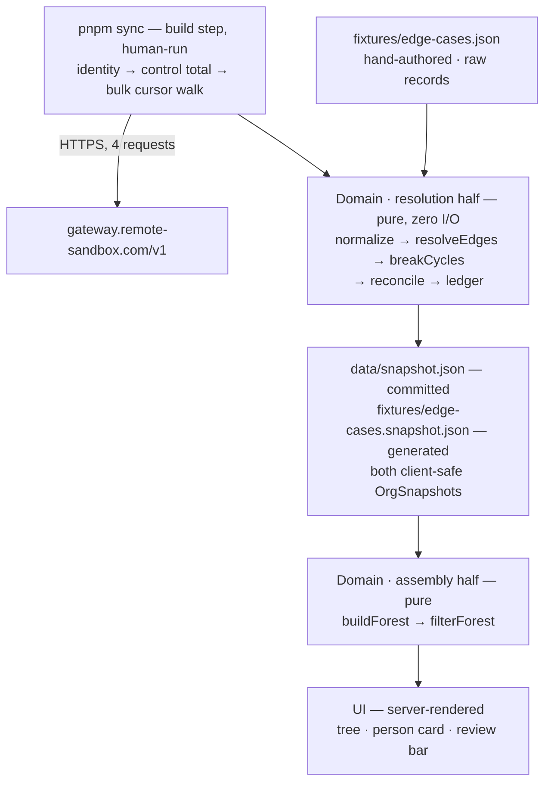

# Org Chart — Build Specification

**Version:** 1.19 · 2026-08-22. Revision history at the foot of this document.

**Project:** **acme-org-chart** (the package name in `package.json`).
**System:** Organizational chart for the company the API token resolves to. The project name is **acme-org-chart**; the issued sandbox company is **CatarinaFDE Demo2** (`5ca666ff-…`, 191 employments), not the "Acme Sandbox Corp" the engagement brief describes — see §D.5.
**Data source:** Remote Customer API (sandbox) · `gateway.remote-sandbox.com/v1`
**Deployment:** The real UI is confirmed live at **https://remote-org-chart.vercel.app** as of 2026-08-22.
**Budget:** 8 hours of focused work
**Document status:** Authoritative. This is the single specification for what is built, how it behaves, and what it guarantees.

**Scope rule:** every element specified here satisfies a stated requirement, or removes a failure mode that would otherwise be silent *and* costs under thirty minutes to build. Everything that failed that test is listed at the end of this document under **Deliberately out of scope**, with the condition under which it becomes worth building.

---

## System shape

The sync is a **build step**, not a runtime path. A human runs `pnpm sync`; it walks the API once, projects the result to a client-safe model, and writes `data/snapshot.json`. That file is committed and ships in the bundle.



**The domain sits on both sides of the snapshot, and the split is by what the answer depends on.** Resolution — how a record becomes a person, which parent each edge points at, where a cycle is cut, what the ledger says, and whether the counts reconcile — depends only on what the API returned, so it is decided once, under `pnpm sync`, and its results are written into the artifact. Assembly — the forest, its ordering, its depths and counts, and any filter — depends on the request, so it happens at render.

Two consequences follow, and both are the reason for the split rather than side effects of it. `Provenance.countReconciled` and `contentHash` are fields *of* the snapshot, so reconciliation and hashing must precede the write; a check that ran after the file existed could not be recorded in it. And because resolution is a pure function running at build time, the edge-case fixture stays a set of raw records and its served form is generated from it (§D.5).

**The deployed application performs no network I/O and holds no credential.** That is the load-bearing decision in this design, and it follows from a property of the data: org structure changes on a scale of weeks, so runtime freshness buys almost nothing here. Making the sync a build step removes, rather than solves, an entire class of problem — concurrent cold-cache syncs, retry amplification against a company-wide rate budget, a bad sync overwriting a good snapshot, and a revoked token scheduling authenticated calls forever.

It also converts the one hard constraint of this exercise into a structural guarantee. **Sandbox access is revoked 14 days after provisioning.** A system that fetches at runtime has to defend against that with a fallback ladder. A system that fetches at build time is simply unaffected: the public URL renders identically on day 40.

Everything that can be wrong about the data — a cycle, a dangling pointer, a manager outside Remote, a malformed record — is decided inside a pure function from `EmploymentRecord[]` to `OrgSnapshot`. That is what makes the guarantees in §F testable rather than asserted.

### Timebox

| Block | Hours | Output |
|---|---|---|
| **H0 · Contract spike** | 0:00–0:45 | `curl` identity, control total, and one bulk page. Confirm the token carries `employment:read`. **Redact each body at capture per §I.1**, then save into `fixtures/captured/`. |
| **H1 · Sync + deploy** | 0:45–2:30 | `RemoteClient`, Zod projection, cursor walk, **and the domain's resolution half** — normalize · ledger · resolve-edges · break-cycles · reconcile — since `pnpm sync` writes a complete `OrgSnapshot` and cannot do so without them. **A hello-world is deployed to Vercel in this block**, not at the end. |
| **H2 · Domain · assembly** | 2:30–3:30 | build-forest · filter · the fixture bake. Pure. **The README's architecture rationale and out-of-scope table are written here**, while the decisions are being made. |
| **H3 · Tests** | 3:30–4:15 | Edge-case fixture + one test per ledger code + conservation law + determinism. ~15 tests. |
| **H4 · UI** | 4:15–6:15 | Screen topology per §H.3: tree, person card, toolbar, review bar. |
| **H5 · Buffer** | 6:15–7:00 | Reserved. Deployment is already live and needs only a push, so this hour absorbs H4 rather than funding new scope. |
| **H6 · Write-up** | 7:00–8:00 | README completion: setup, verification without a token, assumptions, limitations. |

Two of these placements are deliberate rather than incidental. Deployment sits in H1 because it is the one failure that cannot be recovered at hour 7.5, and with no environment variable to configure it costs ten minutes to remove from the critical path entirely. The README's reasoning sits in H2 because it carries the scope decisions, and the block carrying the scope decisions must not also be the block that absorbs an overrun — which is what the last block always becomes.

The H1/H2 boundary moved thirty minutes later in 1.3 and the two blocks were renamed, because the domain divides by *when it runs* rather than by being one unit of work (§G.1). Five of its modules are prerequisites for `pnpm sync` producing anything at all, so they cannot sit in a block after it. H2's own work shrinks correspondingly, which is why the reallocation is a shift rather than an overrun.

---

## A. Users and use cases

Two user classes. The operator's needs define the product; the evaluator's needs define the delivery.

### A.1 First-time evaluator (primary)

An engineer opening the deployed URL with no context, no credentials, and no setup — possibly after the sandbox token has been revoked.

| # | Use case | System obligation |
|---|---|---|
| R1 | Open the public URL cold and see a populated chart | No login, no empty state, no client-side fetch on first paint |
| R2 | Understand the hierarchy without interacting | Every root branch is open by default, exposing its immediate reports; report branches start collapsed |
| R3 | Inspect how imperfect data is handled | The Data diagnosis panel is present on every view inside the review bar (§H.3), and is deep-linkable |
| R4 | Establish whether the data can be trusted | Capture line in the header on every view; the full provenance block, including the walk's own counters, in the review bar |
| R5 | Clone the repo and run it with no `.env` | `pnpm i && pnpm dev` renders the committed snapshot |
| R6 | Exercise the edge-case handling | The review bar's source selector switches the deployed app to the edge-case fixture |

### A.2 The People Operator

Owns the workforce data, not the integration. Every feature traces to one of these.

| # | Use case | System obligation |
|---|---|---|
| P1 | "Who reports to whom across the company?" | Tree with direct-report counts and collapse/expand |
| P2 | "Who has no manager, and who is unreachable in the hierarchy?" | Data diagnosis panel: `ROOT_NO_MANAGER`, `MGR_DANGLING`, `MGR_EXTERNAL`, and the same finding on the affected person's card |
| P3 | "What exactly do I send HR to fix?" | Every finding retains a reason code, privacy-safe evidence, severity, owner, and next step; the UI presents fixed code-level guidance once and variable record evidence separately |
| P4 | "Where does one person sit, and what is their chain to the top?" | Selecting a person renders the full chain to root |
| P5 | "Is this chart complete?" | Conservation counter and count reconciliation, displayed on screen |

---

## B. Functional requirements

Every requirement is a testable statement. `Brief` denotes a requirement stated in the engagement brief; `Added` denotes an engineering addition that satisfies the scope rule.

| ID | Requirement | Acceptance test | Source |
|---|---|---|---|
| **F1** | `pnpm sync` walks company identity, a control total, and all employments into one normalized, client-safe snapshot | Bulk walk reaches `next_cursor === null` with no repeated cursor and no duplicate employment ID; `listTotalCount === recordCount − deletedCount`; total requests equal `2 + ceil(N/100)` | Brief |
| **F2** | Build a reporting **forest** from the employment set, recording how each edge was determined | Unit tests over fixtures for: multi-root, cycle, self-manager, dangling pointer, external manager, duplicate name. Every `ReportingEdge` carries a `basis` | Brief |
| **F3** | Render a collapsible hierarchical tree as the primary visualization. Root branches open by default; every direct report's own branch starts collapsed | First paint shows who reports directly to each root without flooding the view with the next level. Every node card shows name, job title, department, and direct-report count. Fully operable by keyboard with `role="tree"` semantics | Brief |
| **F4** | Show a person's full reporting line to the root | Selecting a person renders `CEO → VP → Director → person`; the selection is reflected in the URL as `?person=<employmentId>` and restores on paste | Brief |
| **F5** | Handle missing data and structural anomalies gracefully and **visibly** | No record is silently dropped: `recordCount === nodesPlaced + recordsQuarantined`, asserted in a unit test. The toolbar always shows `listed · charted`; it adds `quarantined` only when nonzero. The complete `walked · deleted · listed` and `walked · placed · quarantined` equations remain in Data diagnosis | Brief |
| **F6** | **Data diagnosis panel** — every exception with a reason code, diagnosis, privacy-safe evidence, severity, owner, and the next step that resolves it | ReviewBar findings group by `scope` and code. Human label, code badge, diagnosis, owner, severity, and next step render once per code; affected records and variable evidence remain row-level. Evidence identical across a group renders once. Record-scoped findings additionally render label/code badge → evidence → next step → owner on the affected person's card; diagnosis and severity remain in ReviewBar | Added |
| **F7** | Provenance on every view | The header carries the capture line in plain language and the viewer's locale, with relative age alongside. The full block — `apiCallCount`, `pageCount`, `terminalCursorReached`, `countReconciled`, `contentHash` — renders in the review bar. Correct for both sources | Added |
| **F8** | Runs with zero credentials, and the edge-case dataset is selectable **on the deployed system** | `git clone && pnpm i && pnpm dev` with no `.env` renders the full chart. The review bar's source selector switches between the committed snapshot and the fixture, and the selection is reflected in the URL | Added |
| **F9** | Filter the tree by name, job title, or department | Typing a query narrows the tree to matching nodes and their ancestors, with ancestors marked as context rather than as matches. Selecting a department — including the Unassigned bucket — narrows it the same way, and the two compose. Both are reflected in the URL | Added |

**On F8.** The two capabilities are one mechanism serving two guarantees. *Zero-credential operation* means anyone holding the repository can run and modify the system with no access to Remote — a property of the handover, not a convenience. *A selectable fixture on the deployed system* means the edge-case handling in §F is demonstrable regardless of what the real dataset happens to contain: data quality is a property of the source, and a clean dataset must not make the handling of a dirty one unobservable. The fixture is the same dataset the test suite runs against, so what is demonstrated in the UI is exactly what is asserted in CI.

---

## C. Non-functional requirements

Each target is falsifiable and each has one named mechanism.

| # | Attribute | Target | Mechanism |
|---|---|---|---|
| 1 | **Speed** | First paint carries the complete chart. Zero API round trips at request time. Expand, filter, and select respond within one frame at company scale | The snapshot is a static import. Server components render from it directly, so there is no partial-load state to design, render, or test. `O(n)` normalization, edge resolution, and forest construction; derived metrics computed once during `buildForest` |
| 2 | **Accessibility** | WCAG 2.1 AA contrast in both themes; the tree is fully keyboard-operable; the ledger is a real `<table>` | `role="tree"` / `treeitem` / `group` with arrow-key navigation and roving tabindex; visible focus rings. Verified by a manual axe pass and a full keyboard traversal |
| 3 | **Security** | No API token exists anywhere in the deployed system | The token is read by the sync script only, from the local environment, and never by application code. The deployed host has no Remote credential to leak, log, or spend. `.env.example` only; `.env*` git-ignored |
| 4 | **Privacy** | The committed artifact contains only the fields required to render an org chart | The projection in §D.2 **never reads an email field**. No email, address, compensation, contract, or raw Remote payload enters the snapshot, the ledger, a log, or a committed fixture (§I.1) — the claim holds across the whole repository, not only across what the system generates. `X-Robots-Tag: noindex` — synthetic or not, employee-shaped data should not be indexed |
| 5 | **Correctness** | Every record is schema-validated; pagination is provably complete; no silent partial load; every graph anomaly is surfaced | Zod per record over the narrow projection; terminal-cursor and uniqueness guards; cross-endpoint count reconciliation (§G.2); the conservation law |
| 6 | **Maintainability** | A stranger changes the manager-resolution rule by editing one file, and a failing test tells them if they broke it | Hard module boundary (§H.2), enforced by lint rule. Strict TypeScript; no `any`, no non-null assertion on API data. `domain/` imports nothing from `next`, `react`, or the client, so it serves another org-chart source by writing one adapter. Comments state invariants; they never restate the code |
| 7 | **UI/UX** | Clear visual hierarchy, legible at 360px, correct in light and dark, no layout shift on expand | Tailwind design tokens; CSS-grid indentation with connector rails drawn as borders (§H.3); any measurement stays inside the tree component and may not produce shift on expand; transitions on transform and opacity only |
| 8 | **Testability** | Every guarantee in §F has a named test; the suite runs with no network and no credential | Vitest over committed fixtures. One test per ledger code, plus the conservation law, the `country` projection shape, and a determinism assertion (§G.3) |

---

## D. Entities and relationships

Two layers held strictly apart: what the API returns, and what the domain derives. No UI component ever touches a raw Remote shape.

### D.1 Source entities, as returned

| Entity | Key fields | Cardinality |
|---|---|---|
| **Company** | `id`, `name` — from `/v1/identity/current` | 1 → N Employment |
| **Employment** | `id` (UUID, the person key), `short_id`, `company_id`, `full_name`, `job_title?`, `department?`, `department_id?`, `country?` *(an object — see §E.4)*, `type`, `status`, `user_status?`, `employment_lifecycle_stage`, `updated_at?`, `manager` (name string), `manager_employment_id?` | N → **0..1** Employment, self-referential via `manager_employment_id` |

**The cardinality is the central design constraint.** An employment has at most one manager. Matrix reporting, dotted lines, and co-managers are not expressible in Remote's employment model, so they are not in this system's model either. True matrix hierarchy lives in `company-structure-nodes`, a separate dimension that is out of scope (§E.3).

### D.2 Staging projection

The sync script parses and retains **only** these fields from each bulk record. Everything else in the Employment payload is discarded at the boundary, before anything is written to disk:

`id` · `short_id` · `company_id` · `full_name` · `job_title` · `department` · `department_id` · `country.name` · `country.alpha_2_code` · `type` · `status` · `user_status` · `employment_lifecycle_stage` · `manager` · `manager_employment_id` · `updated_at`

The parse also **returns the counts taken at stage one**: how many records were walked, how many were quarantined, and how many carried each of the classifications §G.2 subtracts. They are returned rather than recomputed because a quarantined record is invisible downstream — its `status` was readable only during the pre-pass, and §G.2's identity is wrong by exactly the number of quarantined-and-deleted records if that value is not captured where it exists.

**No email field is read at all** — not `work_email`, not `login_email`, not `manager_email`, not `personal_email`. This is stronger than reading emails and stripping them later, and it is possible because the edge ladder in §D.6 resolves managers by ID or by name, never by email address (see the note on email inference under **Deliberately out of scope**).

Parsing happens in **two stages**. A minimal pre-pass reads `id` and `status` — two fields whose absence would mean the response is not an employment list at all — and every walked record passes through it. The full projection is then validated per record; a failure quarantines that record as `RECORD_INVALID`.

The pre-pass is not decoration: a quarantined record must still be **counted** and still be **classifiable as deleted**, or the count reconciliation in §G.2 would render a green check while being false.

**The pre-pass reads exactly `id` and `status`.** It briefly also read `user_status` and `employment_lifecycle_stage`, non-fatally, while §G.2's identity was unsettled and every candidate term had to be measurable. The walk settled it on `status` alone, so those two came out — the counts they produced are recorded in §G.2 and the code that produced them is gone, which is the right direction for a measurement that cannot be repeated without a token but also never needs to be.

Both stages run in `lib/ingest.ts` — the one module that turns raw records into validated ones, imported by every script that reads them, the bulk walk and the fixture bake alike. It calls the schemas in `lib/schemas.ts` and raises `RECORD_INVALID` through `ledger.issue()` rather than authoring the code itself, so both the parse and the code keep a single owner (§H.2). A parse living inside a script's `main()` would satisfy neither: §I.1 requires a test for every §F.1 code, and code reachable only by running a script against a token has no test layer this document admits. `normalize.ts` therefore receives records that have already satisfied the projection and cannot fail.

A record that fails **the pre-pass itself** has no readable identity, and the invariant has to say what becomes of it rather than argue that it cannot happen. It is counted in `recordCount` and quarantined as `RECORD_INVALID` with a null `employmentId` and a canonical diagnostic position — `record 117 of 191` — so both the conservation law and raw-order determinism stay total while the walk continues. Such a record cannot be classified as deleted, so a nonzero pre-pass failure count is itself the explanation for any `COUNT_MISMATCH` raised alongside it.

**The position is canonical, not an arrival index or page coordinate.** Cursor pagination promises no stable arrival order, while §G.3 includes `safeDetail` in the hash; writing the walk index into that field would make unchanged raw records hash differently after a reorder. `ingest` therefore places every record that passed the pre-pass in a conceptual prefix, then orders the pre-pass failures by their privacy-safe field-path set and assigns consecutive one-based positions. Equal failures are interchangeable because no rejected value enters their finding; the resulting finding multiset is identical under every permutation. The position stays flat and unique, works unchanged for `bake-fixture.ts`, and reads no undeclared payload field to establish its order.

### D.3 Derived entities

| Type | Purpose |
|---|---|
| `Person` | Flattened, null-safe view of one employment. The only person shape the UI knows |
| `ExternalManager` | A manager named on a record but not managed through Remote. Synthetic, namespaced, rendered in the tree, excluded from the conservation law |
| `UnresolvedManager` | A placeholder standing in for a `manager_employment_id` that points outside the fetched set. One per distinct missing ID |
| `ReportingEdge` | Makes *how* a reporting line was determined a first-class inspectable fact rather than an implementation detail |
| `DataIssue` | One row of the exception ledger. The Data diagnosis panel and the audit record are the same object |
| `OrgNode` | Everything the tree and the breadcrumb need, precomputed once during forest construction |
| `Forest` | A forest, not a tree. Multiple roots are the normal case, not an error |
| `Provenance` | Answers "where did this number come from, and when" without asking the author |

### D.4 The model

Every type below is transcribed in `domain/types.ts`, which imports nothing. One type that is *not* in this section lives there too: `EmploymentRecord`, the §D.2 projection expressed as a plain type. It belongs in the domain because `normalize()` consumes it and §H.2 makes `domain/` importing `lib/` a build error — dependencies point inward. `lib/schemas.ts` annotates its Zod projection against it, so the parser and the domain's input contract cannot drift apart without failing to compile.

`OrgSnapshot` is the **on-disk** shape of `data/snapshot.json`, not merely a render-time container. Everything in it is produced by the resolution half of the domain, under `pnpm sync`; `OrgNode` and `Forest` are produced at render and are never serialized, which is why `Forest` can carry a `Map`.

```ts
/** The complete client-safe payload. Everything rendered comes from this object. */
type OrgSnapshot = {
  schemaVersion: 1;
  company: { id: string; name: string };
  people: Person[];
  externalManagers: ExternalManager[];
  unresolvedManagers: UnresolvedManager[];
  edges: ReportingEdge[];
  issues: DataIssue[];
  provenance: Provenance;
};

type Person = {
  employmentId: string;        // authoritative person key for this integration
  shortId: string | null;      // display disambiguation only — never a join key
  name: string;
  jobTitle: string | null;
  department: { id: string | null; name: string | null };
  country: { name: string | null; code: string | null };  // exactly two leaves of NullableCountry
  employmentType: string;      // passthrough union — see §E.4
  employmentStatus: string;    // open vocabulary by design — see §E.4
  userStatus: string | null;
  lifecycleStage: string;
  updatedAt: string | null;
};

/**
 * Which nulls a People Operator must act on, and which are merely absent (§F.2).
 * A critical null renders a `Missing` marker naming its owner; everything else
 * renders an em-dash. Absence of a manager is structural and is carried by
 * ROOT_NO_MANAGER instead.
 */
const CRITICAL_FIELDS = ['jobTitle', 'department'] as const;

/**
 * A manager named on an employment who is not themselves managed through Remote.
 * Synthetic: no employment, no Remote identity, never counted by the conservation law.
 */
type ExternalManager = {
  id: string;                  // `external:<slug>` — namespaced, cannot collide with a UUID
  displayName: string;         // from Employment.manager, the only field trusted here
};

/** Stands in for a manager ID that resolves to nothing. Reports attach here rather than vanish. */
type UnresolvedManager = {
  id: string;                  // `unresolved:<managerEmploymentId>`
  missingManagerId: string;    // read by the node's display name (§H.3). There is one
                               // placeholder per distinct missing id, and they are roots
                               // in a forest the real data shows is 42 wide
};

type ReportingEdge = {
  reportEmploymentId: string;
  parentId: string | null;     // an employmentId, an `external:` id, or an `unresolved:` id
  basis: 'manager_employment_id' | 'external_name' | 'unresolved' | 'cycle_broken' | 'none';
  // 'cycle_broken' is a parentless edge that *had* a parent until §D.6 rule 3 cut it.
  // 'none' means the record never named a manager. Collapsing the two would make
  // `basis` false on exactly the edges a reader most needs to distinguish.
};

type DataIssue = {
  code: IssueCode;             // the closed set in §F.1
  scope: 'record' | 'sync';    // a finding about one employment, or about the walk as a whole.
                               // Decides where it may render (§H.3) — `employmentId === null`
                               // cannot, because a pre-pass failure carries a null ID too (§D.2)
  severity: 'info' | 'low' | 'medium' | 'high';
  employmentId: string | null;
  displayName: string | null;
  safeDetail: string;          // no email, no token, no raw Remote payload
  suggestedOwner: 'People Ops' | 'Integration owner';
  suggestedAction: string;     // audit-compatible diagnosis + next step, fixed per code in ledger.ts
};

type Provenance = {
  source: 'remote_sandbox' | 'synthetic_fixture';
  environment: 'sandbox';
  capturedAt: string;                  // ISO 8601
  companyId: string;
  pageCount: number;
  recordCount: number;                 // employments walked, counted at the pre-pass
  quarantinedCount: number;            // of those, failed the full projection -> RECORD_INVALID
  deletedCount: number;                // of those, status === 'deleted', read at the pre-pass
  listTotalCount: number | null;       // control total from /v1/employments
  countReconciled: boolean;            // the identity in §G.2 check 2. A null listTotalCount
                                       // is not a runtime state to render: a control total
                                       // that cannot be read removes COUNT_MISMATCH from
                                       // §F.1 altogether, rather than leaving this field
                                       // with no defined value
  terminalCursorReached: boolean;
  contentHash: string;              // covers the snapshot's data with `capturedAt` and
                                    // this field itself excluded — see §G.3. That
                                    // exclusion is what makes a git diff on the
                                    // committed snapshot mean the data changed rather
                                    // than that it was re-fetched
  apiCallCount: number;
};

/** Derived once during buildForest; never recomputed per render. */
type OrgNode = {
  id: string;
  kind: 'person' | 'external' | 'unresolved';
  person: Person | null;       // null for synthetic nodes
  displayName: string;
  children: OrgNode[];
  depth: number;
  pathToRoot: string[];        // ancestor ids, nearest first
  directReports: number;
  totalDescendants: number;
};

type Forest = {
  roots: OrgNode[];            // ordered by the rule in §G.3, never by arrival order
  byId: Map<string, OrgNode>;
  maxDepth: number;            // consumed by the toolbar summary line (§H.3) — a derived
                               // field with no reader is a field that should not exist
  principalRootId: string | null;
                               // Which node is the head of the organization is a domain
                               // decision (§H.3 person card), so it is decided in the layer
                               // that owns decisions rather than joined together in a
                               // component. Null only if no root qualifies — an organization
                               // consisting entirely of synthetic and cycle-cut roots.
};
```

### D.5 The two sources

| Source | Selector value | Served file | Header identity | Role |
|---|---|---|---|---|
| **Committed snapshot** | `?source=snapshot` (default) | `data/snapshot.json` | `CatarinaFDE Demo2` plus capture line | The real organization. Written by `pnpm sync`, committed, ships in the bundle |
| **Edge-case fixture** | `?source=fixture` | `fixtures/edge-cases.snapshot.json` | `Edge Case Fixture` plus capture line | The zero-credential run path and the demonstration surface for §F |

Both served files are `OrgSnapshot`s, so `source.ts` statically imports one or the other and never converts. The fixture's served form is **generated, not authored**: `fixtures/edge-cases.json` holds raw records and drives ingest plus the resolution-half tests; the resolution half produces the `.snapshot.json` beside it, and assembly-half tests consume that generated `OrgSnapshot` because it is their actual input contract. Both forms are committed and the bake runs before the suite.

That indirection is what makes F8's claim true rather than merely plausible. Authoring the served form directly would state the resolver's output as the resolver's input, so every ledger-code test would pass even if `resolve-edges.ts` were wrong — the same defect that keeps `isDeparted` a predicate rather than a stored field (§E.4). The sibling is regenerated by the command CI runs, so a stale one fails the build rather than the eye.

**The fixture's own `company.name` is `Edge Case Fixture`.** The real path reads the name from `/v1/identity/current`; the fixture makes no such call and no raw record carries one, so the value has to be fixed somewhere and it is fixed here. It is deliberately not company-shaped, and `company.id` is `fixture-company` for the same reason.

**The company name is rendered from `snapshot.company.name`, never from a constant.** H0 established that the issued sandbox resolves to *CatarinaFDE Demo2* with 191 employments, not the *Acme Sandbox Corp* at ~42 that the engagement brief and Remote's own first-call documentation describe. No code changed as a result — the header was already specified to read the snapshot — but the example copy above is now the real string, and the README states the discrepancy rather than repeating the brief's illustrative name.

The fixture is **selected, never fallen back to**. Synthetic records must never be served as though they were the customer's organization — the one case where usability and integrity genuinely conflict, and integrity wins. If `data/snapshot.json` is absent or unparseable, the system renders the empty state of §F.2 naming the cause, not the fixture.

**When the fixture is selected its source remains explicit without a header banner.** The header renders the data-owned name *Edge Case Fixture*, the Data diagnosis source selector identifies the fixture, and the document title changes to match. The former *Demo data — synthetic fixture, not real company data* banner is intentionally removed from the header as redundant.

The header reports what the data **is**, and always renders age relatively with the absolute time alongside, so a reader never has to subtract dates to learn how stale the chart is.

### D.6 Edge resolution — the rule that determines the graph

Resolve each employment's parent by descending this ladder, stopping at the first hit. Record the basis on the edge. **An inference is never silently promoted to a fact.**

| # | Condition | Result | `basis` | Ledger |
|---|---|---|---|---|
| 1 | `manager_employment_id` present and resolves within the fetched set | Authoritative edge | `manager_employment_id` | — |
| 2 | `manager_employment_id` present but resolves to nothing | Person retained, attached to an `UnresolvedManager` placeholder root — one per distinct missing ID | `unresolved` | `MGR_DANGLING` |
| 3 | No manager ID, but `manager` names someone | Synthetic `ExternalManager` node, **rendered in the tree**, visually distinct | `external_name` | `MGR_EXTERNAL` |
| 4 | No manager information at all | Legitimate root | `none` | `ROOT_NO_MANAGER` (info) |

Four rules make this deterministic rather than merely described.

**1 · A broken pointer outranks a name, and never falls through.** Rung 3 requires that no manager ID be present at all. Without that clause, a record with an unresolvable ID *and* a populated manager name — which is nearly every such record — would become an external manager, and `MGR_DANGLING` would never fire for anyone. An ID that points nowhere is evidence of a source-system fault; routing around it with a weaker field would hide the fault while producing an edge that looks authoritative. Rungs 1 and 2 are mutually exclusive with 3 and 4 by the presence of the ID alone, so **every employment carries at most one `MGR_*` code and exactly one edge.**

**2 · External managers merge on name, and the merge is order-independent.** The slug is a pure function of the manager name — trim, Unicode NFC, lowercase, collapse internal whitespace, in `domain/fold.ts` and nowhere else (§H.2) — so six employments naming the same manager produce **one** node with six children regardless of arrival order. IDs are namespaced `external:<slug>` so a synthetic ID can never collide with an employment UUID.

**The display name is the raw `manager` string from the record holding the lowest employment ID in the merged group.** A slug that is order-independent is not enough on its own: `displayName` sits *inside* a hashed collection, so leaving it to arrival order would make `contentHash` arrival-dependent too. Ascending employment ID is the tiebreak because this document already breaks three others that way — the cycle cut below, root ordering, and principal-root selection (§G.3, §H.3) — and a fourth tie broken a fourth way would itself be the defect. The string stays raw because normalization is what the slug is for. Modal form was rejected: it needs a tiebreak anyway, and it makes one node's text depend on how many records happen to name that manager.

*Stated limitation:* with no manager email in the projection, two distinct people who share a full name would merge into one external node. This is recorded in the README rather than guessed at — the alternative, keying on a personal identifier, would put an email address into a public artifact to fix a case that requires two *externally managed* managers with identical full names. The population in which that collision can occur is the set of rung-3 managers, which H0 measured at zero across the first hundred records; at 191 employments the premise is weaker than it would be at the ~42 the engagement brief illustrates, which is why it is stated as a limitation rather than dismissed as impossible.

External managers are rendered rather than hidden because the customer wants their organization, not the Remote-managed subset of it. Dropping the line to a manager paid through a different system leaks an integration boundary into the customer's view of their own company. The node renders *and* the ledger reports it; those were never alternatives.

**3 · Cycles are cut by construction, at a node chosen independently of traversal order.** After edges are built, a DFS with colour marking detects self-references and loops of any length, and re-parents the affected member to a root. The forest is acyclic because it was made acyclic, not because the data was trusted.

Which edge gets cut cannot be left to "wherever the back-edge was found," because that depends on where the traversal started. The rule: **iterate nodes in ascending employment-ID order; on detecting a cycle, enumerate its complete member set, then cut the edge whose child holds the lowest employment ID in that set.** Enumerate first, then choose. The same loop in any input order yields the same cut, the same root, and the same ledger entry.

**A cut edge records that it was cut.** `parentId` becomes null and `basis` becomes `cycle_broken` — never `none`. This is not bookkeeping: a record that named no manager and a record whose manager was deliberately discarded are different facts about the source data, and only the first is `ROOT_NO_MANAGER`. Collapsing them would let a broken loop render as an ordinary second root — indistinguishable from a genuine head of the company in the tree, on the card, and in principal-root selection (§H.3) — while the ledger quietly held the contradiction.

**One cycle produces one ledger row, attached to the member whose edge was cut.** The alternative — a row per member — would triple-count a single defect in a panel whose high-severity total is what a People Operator triages by, and it would make the locked `suggestedAction` false on two rows out of three: *"the chart has placed this person at the top until then"* is true of the cut member and of nobody else in the loop. The other members keep their edges and their positions, which is the point of cutting exactly one. `safeDetail` names every member of the loop in ascending employment-ID order, so the operator sees the whole cycle from the one row. **What this gives up is stated rather than left implicit:** §H.3 renders only the findings belonging to the employment on screen, so the other members' cards stay silent while they sit in a broken loop. The panel carries the whole fact; the card carries it for the member whose reporting line actually changed.

**The cut therefore needs the members' names, not only their ids.** Every other record-scoped code is raised where the employment record is in scope; a cycle is detected over edges, which hold ids alone. A null here would make the highest-severity code the one row a People Operator cannot read without joining back into `people`, against §G.4.2's claim that the ledger stands alone as a handover artifact. The cut is supplied a display-name lookup alongside the edges, and stays pure: it reads the mapping, never derives it.

**4 · The conservation law.**

> `recordCount === nodesPlaced + recordsQuarantined`

Every walked record has exactly one home — the chart or the quarantine. Nothing is dropped to make the picture tidy.

`recordsQuarantined` counts `RECORD_INVALID` only. Four of the remaining codes are annotations on records that *were* placed — a `ROOT_NO_MANAGER` person is in the tree, and counting them as exceptions would turn the invariant red on healthy data. `COUNT_MISMATCH` is neither placed nor excepted: it is a finding about the walk rather than about any employment, which is what `DataIssue.scope` exists to distinguish. That distinction is load-bearing in the UI as well as in the arithmetic — a sync-scoped finding must never appear on a person card, and `employmentId === null` cannot decide it, because a pre-pass failure carries a null ID too (§D.2). **Both synthetic node kinds are excluded from both sides:** external managers and unresolved-manager placeholders were never fetched, so they can be neither placed nor quarantined. Fixtures for both exist before the first test run, so the invariant is exercised against them rather than discovered in a failing build later.

---

## E. APIs

### E.1 The read path

| Order | Call | Supplies | Cost |
|---|---|---|---|
| 1 | `GET /v1/identity/current` | Company `id` and `name`, and a token smoke test | 1 |
| 2 | `GET /v1/employments?page=1&page_size=1` | `total_count` — the independent control total | 1 |
| 3 | `GET /v1/employments/bulk?company_id={id}&limit=100` | Full employment records including manager linkage | `ceil(N/100)` |

**Budget: `2 + ceil(N/100)`.** H0 measured the issued sandbox at `total_count: 191`, so the full sync costs **4 requests** — identity, control total, and two bulk pages — not the three a 42-person company would have taken. Roughly 1.3% of the per-minute company budget, spent a handful of times over the life of the project rather than continuously.

One caveat on that figure, because it is the kind of arithmetic that quietly goes wrong: `N` is the number of records **bulk** returns, while 191 is the control total from the **list** endpoint, which excludes deleted records (§E.4). Bulk does not exclude them, so `N ≥ 191`, and the budget rises to 5 requests if bulk returns more than 200. `Provenance.apiCallCount` is counted by the client rather than predicted, so the recorded value is the measured one either way.

Call 2 is ordered deliberately **before** the bulk walk. It costs one request, returns a single record, and means that if the walk later fails mid-cursor, the operator still knows how many employments the company was supposed to have.

Company ID is read from `/v1/identity/current` rather than maintained as a second hand-copied constant, and sent explicitly on bulk — where it is optional — so requests are self-documenting in logs and stay correct if the token's scope is widened.

### E.2 The observation that determines the read path

Remote's guide *Sync your workforce data efficiently* recommends `GET /v1/employments` for the initial load, and in the same document warns against the per-employee detail loop, citing a customer who reached roughly **8.8 million calls per month** doing exactly that.

`GET /v1/employments` returns a **minimal** employment object carrying `job_title`, `department`, and `department_id` — but **no manager field of any kind**. The recommended path therefore cannot produce an org chart on its own; recovering the reporting edge from it requires precisely the per-employee loop the same guide warns against.

`GET /v1/employments/bulk` resolves this in a single cursor walk: full-detail records, manager linkage included, `ceil(N/100)` calls. It is indexed in Remote's machine-readable documentation as "Bulk list employments," lists both Sandbox and Production servers, and carries no beta, deprecated, or partner-only marker.

**Two consequences for the build.** First, no list-plus-detail fallback is written: a fallback that reproduces a documented anti-pattern is worse than no fallback. Second, the residual risk on bulk is *entitlement*, not documentation status — it requires `employment:read` or an enclosing scope, and the issued token's scope set is not knowable in advance. This is verified at H0 before any code depends on it, distinguishing `403` (valid token, missing scope) from `401` (expired or revoked token).

**H0 confirmed both halves against the live sandbox, so this is now an observation rather than an inference.** `fixtures/captured/employments-list.json` holds a real list response: its employment object carries `job_title`, `department`, `department_id`, `country`, `status`, `type`, and `short_id`, and **no `manager`, `manager_employment_id`, `manager_email`, or `manager_id`** — the recommended path genuinely cannot produce a reporting edge. `fixtures/captured/employments-bulk.json` holds a real bulk page returning `200` with all four manager fields present. Both files are committed, so the contradiction between Remote's guide and Remote's schema is reproducible by a reader holding only this repository.

### E.3 Endpoints evaluated and not used

| Endpoint | Assessment |
|---|---|
| `GET /v1/employments` as a roster | No manager fields at any page size. Its `total_count` is used as the control total; its records are not used |
| `GET /v1/employments/{id}` in a loop | Remote identifies per-employee polling as the expensive anti-pattern. Reserved for single-record refresh under a future webhook (§E.5) |
| `GET /v1/company-departments` | Bulk already carries `department` and `department_id`, which is everything the tree and the filter consume. The canonical list would add only drift detection between free-text and canonical names — a second endpoint, a second scope, and a second failure mode, to report a naming mismatch that changes nothing about the chart |
| `GET /v1/company-managers` | Lists Remote **administrative** users keyed to `user_id`, with values such as `owner`. It is a permissions role, not an employment reporting line. Excluded from graph logic entirely |
| `GET /v1/scim/v2/Users` | Carries manager references and department but no job title; would require a second feed and a cross-resource join |
| `GET /v1/employments/{id}/company-structure-nodes` | Models a distinct hierarchy — cost centre, supervisory org — with `parent` and `attributes`. Per-employment and therefore N+1 |
| Remote MCP | An interactive surface: OAuth-PKCE browser sign-in, acting as the signed-in user and bounded by that user's own permissions. This system is a server-to-server integration authenticating as a Customer API token — a different principal with a different scope set — and Remote's documentation states MCP is not a replacement for the REST API in a deterministic integration. **Excluded entirely.** Nothing here reads from it at runtime or at build time, and the independent cross-check the system does perform is §G.2: same token, different endpoint |

### E.4 Contract characteristics, each with its handling

Every row below is a documented inconsistency or trap found during the API audit. Each costs a line of code and a comment; each would otherwise be found in production.

| Characteristic | Consequence if unhandled | Handling |
|---|---|---|
| `/v1/identity/current` documents its success schema under **HTTP 201**, not 200 | A smoke test asserting `=== 200` reports a false outage on a healthy token | Accept any `2xx` |
| `x-ratelimit-reset` is a **duration in milliseconds**, not a Unix timestamp | Treating it as absolute produces a sleep measured in decades | Parsed as a duration; the unit is asserted in a comment |
| The bulk response carries **no `total_count`** — only `{ data, next_cursor }` | Completeness cannot be verified within the endpoint | Terminal-cursor and uniqueness guards, plus the cross-endpoint control total (§G.2) |
| Bulk accepts **only** `company_id`, `cursor`, `limit` — no status or type filter, though the minimal list endpoint offers all three | Archived and deleted employments arrive unbidden | All visibility filtering happens in the domain layer. This is an API-surface asymmetry, not an implementation shortcut |
| The list endpoint excludes deleted records; bulk does not | A naive `total_count === recordCount` check fails permanently | The invariant subtracts: `listTotalCount === recordCount − deletedCount`. **Verified against the complete walk of 2026-08-22 and confirmed deleted-only.** Bulk returned 191 and the list endpoint reported 191, while 25 records were `archived`, 45 carried an offboarded lifecycle stage and 19 an inactive user status — none of which the list endpoint excludes. The residual is zero and the identity stands as written. It remains true that `deletedCount` was 0 in this sandbox, so the subtraction itself is exercised only by the fixture |
| `country` is a full object (`NullableCountry`), not a string | Projecting it whole would drag country-specific form schemas into a public artifact and multiply snapshot size | Exactly two leaves — `name` and `alpha_2_code`. A test asserts the projected object carries no other keys. The whole field is nullable, so both leaves are `string \| null` |
| The bulk `status` enum is **wider** than Remote's own employment-statuses guide, adding `pre_hire`, `created_awaiting_reserve`, `created_reserve_paid`, `job_title_review`, `pending_post_self_enrollment_actions`, and `offboarding` | A strict `z.enum()` quarantines healthy records the moment Remote adds a value, inflating `RECORD_INVALID` and turning the Data diagnosis panel into a false-positive generator | `status`, `user_status`, `type`, and `lifecycle_stage` parse as `z.string()` and render as received. Strict validation applies to identifiers only |
| **"Terminated" is not a Remote employment status.** No such value exists in either vocabulary | Filtering on it silently matches nothing | Departure is detected from three signals together: `status ∈ {offboarding, archived, deleted}`, `lifecycle_stage === 'offboarded'`, or `user_status ∈ {inactive, cancelled, deleted}`. **H0 correction:** `termination_date` *is* present on bulk records, contrary to the audit's claim that it appears only on the single-record endpoint — but it is the weakest of the four signals and adding it changes no outcome. On the sampled page it was non-null on 6 records, all 6 already flagged by the three signals, while 7 further departed records carried it null. It stays out of the §D.2 projection. **The rule is a predicate over `Person`, never a stored field** — a stored field would be hand-authored into the fixture, making the fixture assert the rule instead of exercising it. The fixture carries the three raw signals; the rule stays under test |
| Bulk prose states `files` is always `null`, while the embedded schema declares it a required array | A faithful validator fails every record | The narrow projection ignores `files` entirely |
| `manager_employment_id` is populated only when the manager is also managed through Remote, and is null otherwise | Assuming the ID is always present drops every externally-managed report | The resolution ladder in §D.6 exists precisely for this |
| **`manager_id` exists on the bulk record and is a `user_id`, not an employment ID.** The audit stated there is no such field; H0 found it populated on all 83 records that carry a `manager_employment_id`, and it never equals that field | **This is the most dangerous field on the record.** Its name reads as the manager pointer, and an implementation that took it would build the graph in the wrong identifier space. In the issued sandbox every one of the 100 sampled employments shares a single `user_id`, so an edge built on `manager_id` would collapse the entire company into one node while looking entirely plausible in code review | Not read, and not in the §D.2 projection. `manager_employment_id` is the sole authority (§D.6 rung 1). Verified: for all 79 records whose manager resolves within the sampled page, `manager_id === resolvedManager.user_id` exactly |
| **`user_id` is not a person key in this data.** All 100 sampled employments share one `user_id` value | Any join, dedupe, or identity decision keyed on `user_id` merges the entire company | The employment ID is the only identity this system uses (§D.1), which this finding independently confirms. It is also why `/v1/company-managers`, keyed to `user_id`, is excluded from graph logic (§E.3) |

### E.5 Auth, transport, and production evolution

- **Base URL:** `https://gateway.remote-sandbox.com/v1`. Production is `gateway.remote.com` — fully isolated accounts and tokens.
- **Auth:** Customer API token, `Authorization: Bearer ra_test_…`, read from the local environment **by the sync script only**. The `ra_test_` prefix is asserted at startup, so an `ra_live_` token fails fast with a clear message rather than producing confusing `401`s.
- **Rate limit:** documented as 300 requests per minute **scoped to the company, not the token**, on a rolling 60-second window. **Measured otherwise:** the sandbox's headers report a ceiling of **1000** — a cold walk's first call returns `x-ratelimit-count: 1`, `x-ratelimit-remaining: 999`. Planning stays on the documented 300 because it is the conservative figure and nothing here depends on the difference at four requests per sync; the measurement is recorded because a budget argued from the published number understates headroom threefold. Every authenticated response carries `x-ratelimit-count`, `x-ratelimit-remaining`, and `x-ratelimit-reset`; a `429` carries all three.
- **Failure taxonomy:** `401` means expired or revoked. `403` means valid but lacking a scope. Different owners, different fixes — separated in the script's exit message.
- **Sandbox lifetime:** access is revoked 14 days after provisioning. The deployed system is unaffected, because it holds no token and makes no call.

**Production evolution.** Beyond this system the correct freshness mechanism is webhook-driven incremental sync rather than polling. `employment.details.updated` is load-bearing: Remote documents it as firing *"whenever an employment `department` or `manager` is updated"* — precisely the two fields this product renders. `employment.status.updated` and `employment.updated` cover visibility and act as a safety net; contract events carry job-title changes, since title is a versioned contract term. Company-manager and company-structure events are not reporting-line updates and would not be subscribed.

Two delivery semantics belong in the README because they are counterintuitive and cost real incidents: Remote retries **only transport failures** — a `4xx` or `5xx` response is treated as delivered and never retried, so a receiver returning 500 on one bad record loses that event permanently — and delivery is at-least-once, deduplicated on event ID. Verification is HMAC-SHA256 over `rawBody + ':' + X-Remote-Timestamp`, compared timing-safely. The receiver verifies, enqueues, returns `2xx` quickly, fetches the named employment once, and never fans out. A periodic full bulk reconciliation remains the backstop.

### E.6 Sources

[Machine-readable index](https://developer.remote.com/llms.txt) · [Bulk list employments](https://developer.remote.com/reference/get_v1_employments_bulk) · [List employments](https://developer.remote.com/reference/get_v1_employments) · [Get token identity](https://developer.remote.com/reference/get_v1_identity_current) · [List company departments](https://developer.remote.com/reference/get_v1_company-departments) · [List company managers](https://developer.remote.com/reference/get_v1_company-managers) · [Authentication](https://developer.remote.com/docs/authentication) · [Rate limit policy](https://developer.remote.com/docs/rate-limit) · [Sync workforce data efficiently](https://developer.remote.com/docs/sync-workforce-data) · [Employment statuses](https://developer.remote.com/docs/employment-statuses) · [Sandbox quickstart](https://developer.remote.com/docs/sandbox-quickstart) · [Available webhooks](https://developer.remote.com/docs/available-webhooks) · [Verifying webhooks](https://developer.remote.com/docs/verifying-webhooks)

---

## F. Edge cases

Edge cases divide into two kinds, and the division is deliberate.

A **ledger code** is a diagnostic event: something about the source data that a human may need to act on. The Data diagnosis panel is a work queue for a People Operator (P3), and a queue that mixes "this employment is in a reporting cycle" with "this name contains an emoji" trains its reader to ignore it.

A **rendering rule** is expected robustness: the system displays unusual but valid data correctly. It is specified and tested, but it produces no row, because there is nothing for anyone to fix.

### F.1 Ledger codes — the closed set

`IssueCode` is a TypeScript union over exactly these six values. Each has a fixture and a named test.

| Code | Trigger | Behaviour | Sev | Owner |
|---|---|---|---|---|
| `ROOT_NO_MANAGER` | No manager fields at all — equivalently, `basis === 'none'`, which a cycle-cut edge never carries (§D.6 rule 3) | Rendered as a root. Multiple roots display side by side as a forest | info | People Ops |
| `MGR_EXTERNAL` | Manager named but not managed through Remote | Rendered in the tree as a synthetic parent — dashed border, no avatar, "outside Remote" label. Merged one node per manager name. Still ledgered, because People Ops may want them onboarded | low | People Ops |
| `MGR_DANGLING` | Manager ID points outside the fetched set | Person retained and attached to an "Unresolved manager" placeholder root. Never dropped to tidy the tree | med | People Ops |
| `CYCLE_BROKEN` | A reporting loop of any length, **including a self-manager** | DFS detects it, one edge is cut deterministically, the member holding that edge is re-parented to a root, and the full loop is named in the ledger. **One row per cycle**, not one per member | high | People Ops |
| `RECORD_INVALID` | A record fails schema validation on a field the graph depends on | Quarantined with the parse error attached. The sync continues; one malformed employee never blanks the chart | high | Integration owner |
| `COUNT_MISMATCH` | `listTotalCount ≠ recordCount − deletedCount` | Snapshot still written and served. **Sync-scoped:** shown in the review bar and in the disclosed conservation detail, never on a person card | high | Integration owner |

#### F.1.1 Locked presentation copy

This table is the authority for operator-facing issue copy. `delivery.md` §3 transcribes it; `ledger.ts` implements it. No component authors or rewrites any of these strings. The stored `suggestedAction` remains `Diagnosis + " " + Next step` so existing snapshots retain their audit contract, while `issuePresentation(code)` exposes the three presentation fields separately.

| Code | Label | Diagnosis | Next step |
|---|---|---|---|
| `ROOT_NO_MANAGER` | `No manager assigned` | `No manager is set.` | `If this person reports to someone, set their manager in Remote; if they are the top of the organization, no action is needed.` |
| `MGR_EXTERNAL` | `Manager outside Remote` | `Their manager is named but not managed through Remote, so the reporting line cannot be verified.` | `Onboard the manager to Remote to make this link authoritative.` |
| `MGR_DANGLING` | `Manager record not found` | `Their manager record could not be found in this company.` | `Re-select the manager in Remote so the link points to a current employment.` |
| `CYCLE_BROKEN` | `Reporting loop detected` | `This reporting line loops back on itself.` | `Review the managers named in the loop and correct the one that is wrong; the chart has placed this person at the top until then.` |
| `RECORD_INVALID` | `Employment record unreadable` | `This record could not be read and is excluded from the chart.` | `Check the field named above against the Remote API contract.` |
| `COUNT_MISMATCH` | `Employment counts disagree` | `The employment list and the bulk export disagree on how many people exist.` | `Re-run the sync; if it persists, the walk may be incomplete.` |

A self-manager is a reporting cycle of length one and the same DFS resolves it identically, so it is `CYCLE_BROKEN` with a loop length of 1 rather than a second name for one behaviour.

**Scope is fixed per code, not decided per instance.** The first five are `scope: 'record'`; `COUNT_MISMATCH` is the only `scope: 'sync'` code. `RECORD_INVALID` is record-scoped even when the pre-pass failure leaves it without an `employmentId` (§D.2) — which is exactly the case that makes the scope field necessary rather than derivable.

**What the real data exercises, measured at H0 over the first bulk page (100 of 191 records).** This is recorded because it decides where each guarantee's evidence comes from, and because a code with no instance in either dataset would be untested prose.

| Rung / rule | Real data | Consequence |
|---|---|---|
| Rung 1 — `manager_employment_id` resolves | 83/100 | Well exercised. The authoritative edge is the common case |
| Rung 4 — no manager fields at all | 17/100 | `ROOT_NO_MANAGER` and the multi-root forest are exercised by real data, not only by the fixture |
| Rung 3 — manager named, no ID | **0/100** | `MGR_EXTERNAL` may have no instance in the real dataset. Its demonstration burden falls entirely on `fixtures/edge-cases.json`, and `?source=fixture` is what makes that observable on the deployed system (F8) |
| Rung 2 — ID resolves to nothing | 4/100 on this page | Not yet `MGR_DANGLING` signal: it is the expected artifact of sampling one page of a 191-person company. Meaningful only after the full walk |
| §F.2 critical nulls | 7 null `job_title`, 7 null `department` | The `Missing` marker and the Unassigned bucket are live on real data |
| §F.2 departed with a team | 1 record | The rule that the toggle never removes someone with direct reports has a real instance, not just a fixture one |

The 0/100 on rung 3 is the sharpest of these. It is the case F8 was written for: data quality is a property of the source, and a dataset that happens to be clean must not make the handling of a dirty one unobservable.

### F.2 Rendering rules — specified behaviour, no ledger row

Each has a test.

| Case | Rule |
|---|---|
| Null in a **critical** field — `jobTitle`, `department` | Never renders a bare em-dash. The dense tree uses the concise `Missing job title` or `Missing department` marker. PersonCard key details retain the actionable `State (Action)` format `Missing <field> (Contact People Ops)` at normal field-value size, with alert color alone distinguishing it. These nulls do not create a ledger row; Data diagnosis remains scoped to the §F.1 structural and sync findings. Unassigned department is additionally its own bucket in the tree and the filter |
| Null in an **informational** field — `country`, `updatedAt`, `shortId`, `userStatus` | Renders an em-dash. Never `undefined`, never `null`, never an empty gap |
| Two people share a full name | Never merged — the employment ID is the only identity. The tree keeps title/department beside the name for scanning; selecting either record exposes its `short_id` in PersonCard for definitive provenance |
| A manager with 40+ direct reports | First 15 shown, "show 27 more" expands. The layout never grows horizontally without bound |
| Depth beyond 8 levels | Indentation caps; the tree scrolls inside its own container; depth is shown numerically on the node |
| Non-Latin scripts, RTL, emoji, very long names | Correct bidi handling; node cards wrap rather than clip; no fixed-width truncation of names |
| Departing or departed staff | **Always rendered, always badged.** The "hide departed" toggle removes only those with no direct reports; anyone with a team stays visible with their badge, because removing them would orphan their reports |
| Zero employments in the snapshot | An empty state naming the likely causes and how to re-run the sync. Not a blank page |
| `data/snapshot.json` missing or unparseable | The empty state names that specific cause. The fixture is never substituted silently (§D.5) |

**Why nulls are tiered rather than treated alike.** A missing job title or department blocks a People Operator from answering their own question — who does this person report into, and where do they sit — so an em-dash there is the system quietly declining to mention a problem. A missing country or `updatedAt` blocks nothing, and marking it would train the reader to ignore the marker in the place it matters. The split is by *consequence to the operator*, not by how often the field is null.

A missing **manager** is deliberately absent from this table: it is a structural condition, already carried by `ROOT_NO_MANAGER` in §F.1 with an owner and an action.

### F.3 Conditions handled structurally

| Condition | Where it is handled |
|---|---|
| API unavailability, rate-limit exhaustion, token revocation | Not a runtime condition. The deployed system makes no API call; a failed sync is a failed build step a human sees and re-runs |
| A person with more than one manager | Not expressible in Remote's model (§D.1). Matrix hierarchy lives in `company-structure-nodes` and is out of scope |
| Idempotency and repeated syncs | A pure domain layer plus canonical ordering before hashing (§G.3) |
| Traceability and audit | The `Provenance` block, the content hash, and the ledger itself (§G.4) |

---

## G. Error handling and reconciliation

**The governing rule: degradation is always preferred to interruption.** No condition in §F produces an error screen. Every failure is absorbed into one of two outcomes — the chart renders with the degraded condition named on screen, or the chart renders and the ledger records what could not be placed.

The single interruption surface is an unhandled render error, caught by a per-view error boundary offering reload and back. Reaching it means a case exists that §F does not cover, which is a specification defect rather than a runtime one, and it is fixed by adding the case rather than by improving the error screen.

Absorption is not concealment. Every degradation is named on screen and counted in the ledger. A system that hides its failures is not resilient; it is merely quiet about being wrong.

### G.1 Layered contracts

The layers split by *when* they run, and the split falls inside the domain rather than at its edge. Everything down to and including domain resolution runs once, in a script, in front of a human; only the last two rows run on every page view.

| Layer | When | Failure modes | Contract |
|---|---|---|---|
| **Transport** | sync | Timeout · DNS failure · connection reset | 10s per-request timeout · 2 retries with exponential backoff and full jitter · **safe GETs only** · then exit non-zero with the failing page index. The previous `data/snapshot.json` is untouched, because nothing writes it until the walk completes |
| **Rate limit** | sync | `429` | Sleep for the `x-ratelimit-reset` **duration** — not a guessed interval — and retry once. At `2 + ceil(N/100)` requests per run this is a guard, not a strategy |
| **Auth** | sync | `401` expired or revoked · `403` valid token missing a scope | **Never retried**; retrying either is pure waste. Exit with the distinguishing message: `401` → "token expired or revoked"; `403` → "token lacks employment:read". Reporting a scope gap as an expiry sends the responder to the wrong fix |
| **Pagination** | sync | Cursor drift · repeated cursor · duplicate IDs · zero-progress page | Reject a repeated or zero-progress cursor; enforce a hard page cap; require `next_cursor === null` before writing. Any violation aborts the write, and the walk's partial result is discarded rather than committed |
| **Schema** | sync | Malformed JSON · unexpected shape · missing field · an HTML error page where JSON was expected | The body is parsed defensively before validation. Then the two-stage parse of §D.2: a minimal `id`/`status` pre-pass over every walked record, then per-record Zod over the narrow projection. A bad record is quarantined as `RECORD_INVALID` and the walk continues. **If more than 20% of records fail, the script refuses to write** and prints the failing field paths — that rate is schema drift, not dirty data, and overwriting a good snapshot with an empty one is the failure mode through which real integrations corrupt customer data |
| **Domain · resolution** | sync | Cycles · self-managers · orphans · dangling pointers · a manager outside Remote | **Never throws.** Every anomaly becomes a ledger entry and every record keeps a place in the graph. The results are written into the snapshot, which is why reconciliation and hashing can be recorded in it at all |
| **Domain · assembly** | render | An edge naming a node the snapshot does not contain · an empty people set | **Never throws.** Assembly is total over any `OrgSnapshot` the resolution half could have produced, so the forest is always renderable. A dangling reference here would be a defect in the writer, not in the data — the data's dangling pointers were already resolved to placeholders at sync |
| **UI** | render | Render error · empty result | Error boundary per view · purposeful empty states that say what to do next · no layout shift |

Note what the build-step boundary buys. A partial or drifted sync cannot reach a viewer, because the artifact it would have to pass through is only written on success — no atomic-swap machinery, no circuit breaker, no concurrency guard. The guarantee is enforced by the shape of the pipeline rather than by controls layered on top of it.

### G.2 Reconciliation — three checks at the end of every sync

Each surfaces in the ledger and in the disclosed conservation detail (§H.3). None throws.

**1 · Cursor reconciliation.** The walk reached a null terminal cursor with no repeated cursor, no duplicate employment ID, and no partial page failure. Reported as `terminalCursorReached`.

**2 · Count reconciliation.** `listTotalCount === recordCount − deletedCount`, comparing the bulk walk against a control total from a **different, independently implemented endpoint**.

The subtraction is required rather than cosmetic: the list endpoint documents that it excludes deleted records, and bulk does not. This makes the check exact, and strictly stronger than any same-endpoint comparison — it fails loudly on the two failure modes that would otherwise ship a confidently wrong chart: a silently truncated cursor walk, and a page lost to a parse error. It reads, once disclosed, as `191 walked · 0 deleted · 191 listed ✓`.

Both terms on the right come from the §D.2 pre-pass rather than the full projection, so a record quarantined as `RECORD_INVALID` is still counted in `recordCount` and still classified in `deletedCount`. Reading `status` only from validated records would leave the identity short by the number of quarantined-and-deleted records — and it would still render a green check while being false.

If the two endpoints ever disagree by something other than the deleted count, the residual is a **finding about the source** to be recorded and modelled — not a check to be relaxed until it passes.

**Settled by the complete walk of 2026-08-22, and it holds exactly.** 191 records walked, `listTotalCount` 191, `deletedCount` 0 — residual **zero**, with no further term required. The three candidate subtrahends were measured and none is excluded by the list endpoint: 25 archived, 45 carrying an offboarded lifecycle stage, and 19 with an inactive user status all appear in *both* endpoints' counts. `Provenance` therefore gains no new count field, and the §D.2 pre-pass narrows to `id` and `status` alone (see below).

**One limitation stated rather than glossed.** `deletedCount` was 0, so while the identity holds, its *subtraction term* was not exercised by real data — the walk confirms `191 === 191 − 0`, which is also what a formula with no subtraction would predict. The term is exercised only by the edge-case fixture, whose `emp-019` carries `status: "deleted"`. The claim this check earns is therefore "the bulk walk and the control total agree on this company", which is what it is for; the claim it does not yet earn from production data is that the deleted exclusion behaves as documented.

The original text of this paragraph is retained below because the reasoning still governs any future re-measurement. The cost is asymmetric: `COUNT_MISMATCH` is high severity and sync-scoped, so §H.3 marks the toolbar summary whenever one exists — a formula wrong by a constant puts a permanent red marker on the operator's default view and makes the panel the false-positive generator §E.4 refuses to accept for enums.

The measurement is four counts over the completed walk — deleted, archived, offboarded lifecycle stage, inactive user status — and the question is which identity holds **exactly**. Whichever does becomes the formula, `Provenance` gains exactly the count fields it needs, and the disclosed line names every term it subtracts. If none holds exactly, `COUNT_MISMATCH` ships as a known-true finding with the residual named. The residual must not be assumed to be the archived count: the list endpoint may filter on lifecycle stage rather than status, in which case no status-based identity matches at all.

**What this check cannot do.** It compares walked records against a control total, and a quarantined record is still a walked record. It is therefore blind to validation outcomes by construction: if every record in the walk failed to parse, this identity would still hold exactly. That gap is closed by the 20% refusal threshold in §G.1, not here.

**3 · Referential reconciliation.** Every `manager_employment_id` either resolves to a fetched employment or is reported as `MGR_DANGLING`. No pointer is left unaccounted for.

**Checks 1 and 3, and the conservation law, have no ledger code, and that is deliberate.** Only check 2 can fail on *data*: two endpoints can genuinely disagree, which is a finding about the source and is what `COUNT_MISMATCH` reports. The other three cannot fail on data by the time they run: a cursor violation has already aborted the walk (§G.1), and every dangling pointer is already an `unresolved:` placeholder with its `MGR_DANGLING` row. A violation there is a defect in *this pipeline*, not in the customer's data, and has no owner in a panel addressed to People Ops.

**So they throw, and this does not contradict §G.1's "never throws".** That contract governs data anomalies — cycles, orphans, dangling pointers, a manager outside Remote — every one of which becomes a ledger entry and keeps its place in the graph. It was never a promise to write an artifact whose own internal accounting disagrees with itself. Refusing to write is the only correct response: the failure is unhandled, the sync exits non-zero, and the previous `data/snapshot.json` is untouched, which is exactly the outcome the build-step boundary exists to make cheap.

**And the invariant that makes graceful handling verifiable:**

> `recordCount === nodesPlaced + recordsQuarantined`

Asserted in a unit test and represented on every view by the toolbar's `listed · charted` summary, with `quarantined` appended only when nonzero. The complete `walked · deleted · listed` and `walked · placed · quarantined` equations remain in Data diagnosis. The operator surface stays concise while any exception remains immediately visible.

### G.3 Determinism

The domain layer is pure, so the same input always produces the same `OrgSnapshot`.

Purity alone does not make *re-syncing* deterministic. Cursor pagination guarantees no stable ordering between walks, so unchanged data can arrive in a different order and serialize to a different byte sequence. **Canonical ordering is therefore part of the contract, not an optimization.** Before hashing and before writing, **all five collections** are sorted on a key that is **unique within that collection** — `people`, `externalManagers`, and `unresolvedManagers` by id, `edges` by `reportEmploymentId`, `issues` by `(code, employmentId, safeDetail)` — and serialization runs through a canonical serializer so the hash covers a defined byte sequence.

**Uniqueness is the property that matters, not stability.** `Array.prototype.sort` has been stable since ES2019, so elements with equal keys keep arrival order rather than being ordered at all — a non-unique key does not fail loudly, it passes arrival order straight into the hash. `issues` therefore needs a third term, because two records failing the §D.2 pre-pass both produce `RECORD_INVALID` with a null `employmentId`; `safeDetail` already carries the canonical diagnostic position §D.2 requires, so no new field is needed and raw permutations remain hash-identical.

**Each collection needs at least two elements in the fixture**, or the sort is asserted by a case that cannot be misordered.

**Forest ordering is part of the contract too, for a different reason.** The canonical sort above covers the five collections that are hashed. `Forest.roots` and `OrgNode.children` are derived at render time and therefore cannot affect `contentHash` at all — but they decide what a reader sees first, and left unstated they follow map insertion order, which is arrival order wearing a different name. That matters more here than the illustration in §H.3 suggests: 17 of the first 100 records carry no manager field of any kind, so the real dataset is expected to open on roughly **thirty roots**, not on one CEO.

- **Roots** sort by kind rank — `person`, then `external`, then `unresolved` — then by `totalDescendants` descending, then by ascending employment ID.
- **Children** sort by display name, then by ascending employment ID.

Kind rank comes first so that the two synthetic kinds collect at the end of the root list instead of interleaving with genuine heads of the organization, which is the same reasoning that excludes them from `principalRootId` in §H.3.

**Root order and `principalRootId` diverge deliberately.** The principal root also excludes `cycle_broken` roots, so the first root in display order can be a cycle-cut person while the card opens on someone else. Forcing agreement would mean either burying a high-severity defect at the bottom of a thirty-root list, where §F.1 requires it visible, or opening the card on that defect presented as the head of the company. The divergence is observable only on data that already carries a `CYCLE_BROKEN` finding.

Name sorting uses a collator pinned to one locale rather than the viewer's, so two people opening the same URL see the same order. Because forest order sits downstream of the hash rather than upstream of it, an ICU version difference between two machines cannot change a snapshot's `contentHash` — which is precisely what makes the display-quality choice affordable here, while the hashed collections stay on a plain code-point sort.

**What the hash covers, and the one thing it must not.** `contentHash` is computed over the canonically ordered snapshot with two fields neutralised: itself, which is self-referential, and `capturedAt`, which is wall-clock. Excluding the capture time is not a convenience — without it the reproducibility claim is simply false, because a second run over unchanged data would differ in that one field and produce a diff. The hash is therefore a hash of *the data*, and says nothing about when the data was fetched. That is exactly the property the claim needs.

**The sync then skips the write when the hash is unchanged.** Both files are left untouched, not rewritten with identical bytes: `data/sync.log` carries its snapshot's `contentHash` so the two are a matched pair (§G.4.4), and rewriting the log alone would break the pair while producing the diff the skip exists to avoid. The retained log is the walk that produced the retained snapshot, which is the only reading under which committing it is worth anything. A re-run that changes nothing reports so on stderr and exits zero.

With that in place, and only with it, re-running the sync over unchanged data is genuinely a no-op. Because `data/snapshot.json` is committed, this has a concrete payoff: **a git diff on the snapshot means the data changed, not that it was re-fetched.** One sort, one hash and one comparison convert the reproducibility claim from an assertion into something a reviewer can check with `git status`.

### G.4 Traceability

1. **Provenance travels inside the snapshot** — source, capture time, company ID, page count, record count, reconciliation flags, content hash, API calls spent. The capture line renders in the header on every view; the counters render in full in the review bar. Neither is buried in a tooltip.
2. **The exception ledger is the audit record.** One object serves both the UI panel and the record of what the sync rejected. No email, token, or raw Remote payload enters it. It is the handover artifact for the customer's People Ops team.
3. **Deterministic and reproducible.** Fixtures committed, domain layer pure, collections canonically ordered before hashing, snapshot content-hashed and version-controlled.
4. **Redacted logs, written with the snapshot.** The sync script logs endpoint, page index, duration, and rate-limit headers as JSON lines. `data/sync.log` is written in the same step as `data/snapshot.json` and carries that snapshot's `contentHash`, so the two are a matched pair rather than two files that can drift apart across runs — a reader comparing them is examining one walk, which is the only reason the log is worth committing. The token is never logged; personal data never enters a log line.

---

## H. Tech stack and topology

### H.1 Choices

| Layer | Choice | Rationale |
|---|---|---|
| Language | **TypeScript, strict** | The problem is fundamentally one of nullable fields and uncertain edges. `strict`, with no `any` and no non-null assertion on API data, makes the compiler enforce the null-handling the system promises |
| Framework | **Next.js, App Router** (pinned to current stable) | Server components render the whole chart at request time from a static import, so there is no loading state and no client fetch. One repository, one deployment |
| Validation | **Zod** | Per-record parsing means one malformed employee is quarantined rather than fatal — the mechanism behind `RECORD_INVALID` |
| Styling | **Tailwind** | A controlled, responsive, dark-mode-correct UI without inventing a design system. Design tokens keep both themes in one place |
| Visualization | **Hand-rolled recursive tree component** | A reporting hierarchy is a nested list. Roughly 150 lines of CSS-grid indentation, keyboard-navigable, screen-reader-correct, correct on a phone, with no dependency risk |
| Tests | **Vitest** over committed fixtures | The guarantees live in the pure domain layer, which needs no DOM, no network, and no credential to test exhaustively |
| Sync | **`tsx scripts/sync.ts`**, run by hand | The sync is an operator action, not a request path. Making that explicit is what removes the circuit breaker, the single-flight guard, and the swap predicate from the system |
| Package manager | **pnpm**, lockfile committed | Reproducible installs for anyone cloning the repository |
| Host | **Vercel** | Next.js is first-party there. No platform-proprietary API is used, so the app runs on any Node host unmodified |

### H.2 Module boundaries

The boundary is the design, and it is enforced by lint rule rather than by intention.

```
scripts/sync.ts             the only file that performs network I/O or reads the token.
                            Ingests, composes the resolution half, writes both artifacts
scripts/bake-fixture.ts     the same ingest and composition over fixtures/edge-cases.json
src/
  lib/remote-client.ts      cursor walk, retries, rate-limit headers — imported only by scripts/
  lib/schemas.ts            Zod: three response envelopes + the §D.2 narrow projection,
                            annotated against domain/types.ts EmploymentRecord
  lib/ingest.ts             the §D.2 two-stage parse. Raises RECORD_INVALID via ledger.
                            Imported by both scripts, so the parse has one owner and one test
  lib/snapshot-writer.ts    canonical ordering, content hash, the drift refusal (§G.3)
  lib/source.ts             selects one of the two OrgSnapshots; never converts, never falls back
  domain/                   pure. imports nothing from next, react, node, lib/, app/ or components/
    types.ts                every type in §D.4, plus the EmploymentRecord input contract
    fold.ts                 the §D.6 rule 2 four-step fold. One implementation, imported by
                            every site that needs it — a rule restated is a rule that drifts
  — resolution half, runs under pnpm sync —
    normalize.ts            EmploymentRecord[] -> Person[]; owns the departure predicate (§E.4)
    resolve-edges.ts        the ladder in §D.6
    break-cycles.ts         DFS colour marking, deterministic cut
    reconcile.ts            the three checks + the conservation law, over people and edges
    ledger.ts               DataIssue construction; the only place IssueCode is authored
  — assembly half, runs per request —
    build-forest.ts         roots, ordering, depth, pathToRoot, counts, principalRootId
    filter.ts               search, department, departed narrowing, and departure visibility counts — F9 and §F.2
  app/                      the single route and its server components (§H.3)
  components/               presentational only; consume Person / OrgNode, never raw API shapes
data/snapshot.json          client-safe OrgSnapshot, committed, ships in the bundle
data/sync.log               redacted transcript of the walk — the evidence chain in §I.1
fixtures/edge-cases.json    authored raw records. Resolution-test input and source of the bake (§I.1)
fixtures/edge-cases.snapshot.json  generated from the above; what ?source=fixture serves (§D.5)
fixtures/captured/          real sandbox response bodies, redacted at capture (§I.1)
```

`domain/` importing from `lib/` or `app/` is a build error. That single rule is what allows the entire §F specification to be verified in seconds with no network and no credential, and what would let the domain layer serve another org-chart source by writing one adapter.

It is also why `EmploymentRecord` is declared in `domain/types.ts` rather than inferred from the schema that parses it (§D.4): the dependency runs inward.

**Only two modules run per request.** Everything else in `domain/` runs once, under `pnpm sync`, and its output is the committed artifact. That is what makes the deployed system's work bounded by the size of the organization rather than by the difficulty of its data.

### H.3 Screen topology

**One route.** The URL is the state container — `?person=` `?q=` `?dept=` `?departed=` `?source=` `?review=` — so every view is linkable and a pasted URL restores exactly what the sender saw.

```
┌───────────────────────────────────────────────────────────────┐
│ HEADER    CatarinaFDE Demo2                                   │
│           Data captured 21 Aug, 2:14 PM · yesterday           │
├───────────────────────────────────────────────────────────────┤
│ TOOLBAR   [ search ]  [ department ▾ ]  [ ] hide departed     │
│           191 listed ✓ · 191 charted · 1 quarantined ·        │
│           45 departed shown · N matching                      │
├──────────────────────────────────┬────────────────────────────┤
│ CHART                      2/3   │ PERSON CARD          1/3   │
│   collapsible tree, depth 2      │   name · job title · dept  │
│   connector rails · legend       │   type · status · country  │
│   expand all · collapse all ·    │   last updated             │
│   restore default view           │   reporting line to root   │
│                                  │   manager →                │
│                                  │   direct reports →         │
│                                  │   data diagnosis (cond.)   │
├──────────────────────────────────┴────────────────────────────┤
│ REVIEW BAR                                            ⌃ / ⌄   │
│   source · ledger by scope and code · reconciliation ·        │
│   provenance counters · sync log · verifying without a token  │
└───────────────────────────────────────────────────────────────┘
```

**The split is by depth, not by audience.** Everything a People Operator needs is on the surface; everything an integration owner needs is one disclosure behind it, in the same components, available to anyone. There is no evaluator-only chrome. An interface that keeps its completeness claim in a reviewer surface is a demo of the product rather than the product, and P5 — "is this chart complete?" — is listed in §A.2 as an operator question.

**Header.** Company name and the capture line, in plain language, with relative age beside the absolute time. **No refresh control:** there is no runtime sync, and a control that cannot act is worse than none — the resync command appears as text in the review bar. The word *provenance* does not appear in the operator surface, and neither does any per-person history: this system holds no durable store, so `updatedAt` on a card is the only history it can honestly claim.

**Toolbar.** The toolbar is one full-width compact grid above the chart/detail split: search, department, departed toggle, then right-aligned accounting and view-state copy. Search and department filter compose; both narrow the tree to matching nodes **and their ancestors**, with ancestors shown for context styled distinctly from actual matches, or the operator cannot tell who matched. **Search is live, not submit-gated:** every input event replaces `?q=` and the server-rendered tree follows without Enter. Clearing the field — including the browser-native clear button on `type="search"` — deletes `q` rather than serializing an empty value, restores the unfiltered search view, and leaves every other URL dimension intact. Toolbar mutations compose from the latest intended serialized state, not only from the last completed `useSearchParams()` render; typing and immediately changing department or departed visibility therefore preserves both actions instead of allowing the later action to overwrite the in-flight query.

The department menu reads *All departments*, then each department, closed by *Unassigned* — the null-department bucket required by §F.2, which a menu that silently omitted it would contradict. **`?dept=` carries the department name, never the id:** §D.1 makes `department_id` nullable independently of the name, so the id cannot address every bucket and cannot address the null one at all. The sentinel for that bucket is the literal `Unassigned`, reusing the label the menu already fixes rather than coining a second string — with the stated limitation that a real department of that name would collide with it. Departments are grouped, for the menu and the filter alike, by the §D.6 rule 2 fold and shown in the form carried by the lowest employment ID, so *Engineering* and *engineering* are one entry and one filter rather than two. **Both halves are owned by `filter.ts`** — it derives the menu's options as well as matching against them, so the grouping the menu offers cannot disagree with the grouping the filter applies. The toolbar renders the list it is given; §H.2 keeps the derivation out of the component.

The departed toggle is here rather than in the review bar, because it is a view control, not a review control. **It defaults to off, so departed staff are shown on first paint.** They are badged, so showing them costs nothing. Because bulk returns deleted employments where the list endpoint excludes them (§E.4), the chart therefore includes deleted records, which the README states rather than leaving a reader to infer from a total that does not match their HR system. The toggle continues to obey §F.2: it removes departed people only after a bottom-up pass proves they have no surviving reports; a departed manager with a surviving team remains visible and badged.

**That qualified behavior must be visible, not inferred from badges.** `filterForest` returns `departureVisibility` beside `forest` and `matchedIds`, with exactly three unfiltered-organization counts: `{ total, hiddenWhenEnabled, retainedWithReports }`. `total` applies `isDeparted` to every person. `hiddenWhenEnabled` is the number the existing bottom-up departed pass would remove with no search or department criterion active. `retainedWithReports` is the departed remainder that must stay to preserve reporting paths. The counts never depend on `q` or `dept`, and `Toolbar` receives them as values; it does not classify people or traverse the forest. The rendered strings are exact: when `total === 0`, `0 departed`; when the toggle is off, `N departed shown`; when it is on, `N departed hidden · M retained with reports`. Against the committed snapshot those states are `45 departed shown` and `41 departed hidden · 4 retained with reports`. The applicable string is appended to the accounting line with ` · `, not rendered on a second line; normal text wrapping may break the combined line responsively.

**Match identity is returned alongside the filtered forest, never stored on a node.** The filter must distinguish a node that matched from an ancestor retained for context, and `OrgNode` is derived once during forest construction and never recomputed per render (§D.4) — putting a match flag on it would make node contents depend on transient query state, so the same forest would hold different values for different requests. The set of matched ids travels beside the forest instead, and no separate count exists — it is the size of that set. `N matching` renders only when a query or department is active: the departed toggle removes nodes rather than matching them. When present, it follows the departed state on the same responsive count line, separated by ` · `.

The accounting line begins `N listed ✓ · N charted`. It appends `N quarantined` only when that count is nonzero, then departed state and, when active, `N matching`, using the same ` · ` separator. Against the committed snapshot the default is `191 listed ✓ · 191 charted · 45 departed shown`; a one-record quarantine would read `191 listed ✓ · 190 charted · 1 quarantined · 45 departed shown`. **Listed, charted, and quarantined always report the unfiltered snapshot.** A filtered forest is a `Forest` like any other, so reading accounting from the current view would make it appear to certify only visible records. Walked and deleted remain available in Data diagnosis rather than the toolbar. Any `scope: 'sync'` finding renders as a visible warning directing the operator to the review details. Accounting, departure visibility, match count, and count reconciliation remain different meanings even though one visually consistent responsive line presents them.

**Chart.** Collapsible tree with every root branch open and every report branch collapsed by default, `role="tree"` with roving tabindex per NFR 2. Parentage is drawn with connector rails — borders on the indent guide rather than paths measured between cards — and any measurement that proves necessary stays inside this component and may not introduce shift on expand. View controls are exactly three: **Expand all**, **Collapse all**, and **Restore default view**. The default view exposes each root's immediate reports without automatically opening those reports' teams. Expansion, sibling reveal, and roving focus are local to one filtered tree view. Changing `q`, `dept`, or `departed` starts a new view at the root-open default; otherwise clearing a narrow result can restore the full forest while retaining expansion state calculated for the narrow forest. Changing `person` or `review` does not reset the tree because neither changes its roots.

Roots render in the order fixed by §G.3, which is what makes depth 2 a usable default on this dataset rather than a wall of undifferentiated cards: the largest genuine subtrees lead, and the synthetic kinds collect at the end. The rule in §F.2 that caps a parent at fifteen visible children applies to the root list itself for the same reason — a forest is the child list of an imaginary parent, and the layout must not grow without bound at the top level either.

The legend is required rather than decorative: the tree carries four visually distinct node kinds — person, external manager, unresolved-manager placeholder, and departed-badged person — plus dashed parentage for synthetic parents, and all of them appear in the operator's default view.

**Person card.** Populated on first paint with the **principal root**: among roots where `kind === 'person'` **and `basis !== 'cycle_broken'`**, the one with the greatest `totalDescendants`, ties broken by ascending employment ID. Both exclusions are load-bearing, and for the same reason — `Forest.roots` holds nodes that are roots by defect rather than by fact. At this company size an external manager with six reports out-descends a genuine CEO, and a cycle member re-parented with a large subtree beneath it does the same; either would open the product on a data problem presented as the head of the company. Defining it by descendant count rather than by position then picks the actual head of the organization rather than whichever no-manager record sorted first, and it satisfies R2 without asking for a click.

**The selection is computed during forest construction and exposed as `Forest.principalRootId`; the card reads one field.** It cannot be computed in the component, because the `cycle_broken` exclusion reads `basis`, which lives on an edge and not on a node — a component would have to join against `edges` at selection time, which puts domain logic in the view against §H.2. Copying `basis` onto every node to avoid the join would spread edge state across the whole tree for a property meaningful only at roots. Forest construction already visits every root, so deciding it there costs nothing.

Manager and each direct report are links that set `?person=`, so the card is a navigation surface rather than a dead end. The **Data diagnosis** block is conditional and renders only `scope: 'record'` findings for that employment. Each finding renders the F.1.1 human label with its code badge, labelled privacy-safe evidence, remediation-only copy under **Next step**, and the owner as secondary metadata. PersonCard omits diagnosis because the compact card already supplies the label, evidence, and action, and it omits severity because prioritization belongs in ReviewBar. `ledger.ts` still owns all fixed copy; PersonCard authors none.

**Synthetic nodes are selectable, and get a reduced card.** External managers and unresolved-manager placeholders render in the tree, so `?person=external:sofia reyes` is one ordinary click away — the slug keeps the collapsed internal space, because §D.6 rule 2's normalisation has no hyphenation step and the URL encodes it. `OrgNode.person` is null for both. Their card carries the display name, a kind label — *Outside Remote* or *Unresolved manager* — the reports attached to the node, and the same compact label/code badge → evidence → next-step → owner sequence for its `MGR_EXTERNAL` or `MGR_DANGLING` finding. Every other field of the full card is **omitted rather than em-dashed**: the §F.2 null rules describe a field that is absent from a record, and these fields do not exist for this node at all. Nothing here is a chain to root either, since a synthetic node is always a root and its `pathToRoot` is empty.

**For an unresolved placeholder the display name and the kind label collapse into one string.** `UnresolvedManager` carries no name — a manager who resolves to nothing has none to carry — so its `OrgNode.displayName` is `Unresolved manager · <missingManagerId>`, and the card omits the kind label rather than printing it twice. The id is shown rather than suppressed because there is one placeholder per distinct missing manager, and `MGR_DANGLING`'s action — re-select the manager in Remote — is unactionable if the operator cannot tell which broken pointer they are looking at. It is also the only reader `missingManagerId` has.

This is the card where P2 and P3 meet — *six people report to someone Remote does not manage, here is who they are, here is what to do* — which makes it worth specifying rather than improvising in the block already carrying the most risk.

**Data diagnosis bar.** Collapsed by default to its title strip; `?review=open` expands it, which is what makes the Data diagnosis panel deep-linkable from the README and the submission email. Its **Findings** subsection groups by scope and code. Each group shows the human label and code badge, diagnosis, owner, severity, and remediation-only next step once; severity pills use gray for info, yellow for low, orange for medium, and red for high. Its semantic table labels the record column **Affected records** and contains only affected records and evidence that actually varies. When every row shares the same evidence, that evidence renders once above the table. The bar also holds the source selector, the three reconciliation checks of §G.2, provenance counters, an excerpt of the sync log, and the pointer to verifying the integration without a token (§I.1). There is no separate diagnosis route, deliberately: findings sit on the same page as the data they describe, and no navigation is asked of the reader.

**Selection survives filtering.** `?person=` and the two filter parameters are independent: the tree shows the filtered result, and the card renders the named person whether or not they survive the filter. The alternative — clearing a selection the filter excludes — would mean a pasted URL does not restore what the sender saw, which is the one thing the URL-as-state-container rule exists to guarantee, and it would break F4 for any link sent alongside a filter. When the selected person is not in the current filter the card says so and offers to clear the filter, because a card with no corresponding node in the tree is otherwise an unexplained state. The chain-to-root breadcrumb always renders the person's real ancestors, filtered or not; a reporting line narrowed by a search box would be a different fact than the one F4 promises.

**Below 768px** the layout is one column. The chart occupies it, and selecting a person opens the card as a full-width overlay driven by the same `?person=` parameter, so dismissing it is a back navigation.

---

## I. Verification

Every guarantee in this document is falsifiable by something in this section. Where a claim has no test, it is an assertion, and assertions are what this specification exists to avoid.

### I.1 What is tested, and at which layer

The whole suite runs in seconds with no network and no credential, which is what makes it worth running on every change. Counts may grow as a guarantee gains an independent falsification case; named behavior, not a target percentage, determines completeness.

| Layer | Covers | Why here |
|---|---|---|
| **Unit — domain** | One test per §F.1 code, five of them here and `RECORD_INVALID` with the parse in `lib/ingest.ts` · the conservation law · rung mutual exclusivity (§D.6 rule 1) · external-manager merge over shuffled input · deterministic cycle cut over shuffled input · root and child ordering over shuffled input, including that `principalRootId` is unchanged by input order (§G.3) | The guarantees live in pure functions |
| **Unit — lib boundary** | Both `id` and `status` pre-pass failures independently · null-id canonical positions under reversed raw input · novel values in `status`, `user_status`, `type`, and `employment_lifecycle_stage` · the complete any-2xx classifier including `201` | These are parser and transport-policy guarantees, not graph rules; each is exercised through the production function that owns it |
| **Contract** | Zod schemas parsed against `fixtures/captured/` — **actual sandbox response bodies**, redacted per the rule below, never shapes hand-written from documentation | Body schemas catch Remote shape changes such as the `country` object. HTTP status is transport metadata and cannot be inferred from a body fixture; the unit row above owns that policy instead |
| **Projection shape** | The projected `country` object carries exactly `name` and `code` and no other key; no field named `*email*` appears anywhere in a serialized snapshot | Privacy (NFR 4) is a property that regresses silently. This asserts it mechanically rather than by review |
| **Determinism** | The same authored raw records in a different arrival order traverse the full resolution pipeline and produce byte-identical JSON and `contentHash` · recursively different object-key insertion order remains byte-identical · changing one hash-covered value changes the hash | Together these pin canonical diagnostic positions, external-manager merging, cycle cutting, all five collection sorts, canonical serialization, and hash sensitivity rather than merely observing one green equality |

**The fixture has two forms, and only one is authored** (§D.5). Ingest and resolution assertions begin with the raw records. Assembly assertions begin with the generated sibling because `buildForest` and `filterForest` consume an `OrgSnapshot`; `buildForest` exercises that baked artifact under input shuffles as well as the real snapshot. The full-pipeline determinism assertion begins raw and ends at serialized bytes. The generated sibling is also what `?source=fixture` serves.

**How captured fixtures are redacted.** They are committed, so they are redacted **at capture**, not before commit — once a raw body is on disk the path of least resistance is to keep it. The identity response retains `data.company` and drops `data.user` entirely, which is the only place in this repository a real person's name and email would otherwise appear. Each employment record retains every field of the §D.2 projection exactly as returned, and every other value is replaced with a type-preserving placeholder: string → `"redacted"`, number → `0`, boolean → `false`, `null` stays `null`, objects recurse, arrays keep their length. Every key and every type survives, which is all the schemas parse — so the contract test above loses none of its power, and NFR 4 holds across the repository rather than only across the artifacts the system generates.

**Verifying the integration without a token.** Because the deployed system makes no API call, the fetch is not observable at runtime — a reader cannot watch it happen, and has no credential to run `pnpm sync` themselves. This is the one place where the build-step architecture is worse for a reader than a live fetch, so the evidence is committed instead of demonstrated. `fixtures/captured/` holds the sandbox response bodies, redacted per the rule above; the contract tests parse the shipped schemas against them, so CI proves the body schemas match reality rather than documentation. Transport status is pinned separately by the production status-classifier test. `data/sync.log` carries the redacted transcript of the walk — page indices, durations, rate-limit headers, record counts. And the review bar renders the walk's own counters, not merely its date: four API calls, two pages, terminal cursor reached, and the §G.2 count identity shown as the arithmetic it performs rather than as a tick. Each of those is checkable by someone holding only the repository.

### I.2 What is deliberately not tested

**No component or snapshot tests.** The UI is a projection of `OrgNode`; a component test would assert that React renders a list. The rendering rules in §F.2 are verified by the accessibility and keyboard pass in NFR 2.

**No load testing.** The deployed system serves a static artifact from a CDN and contends for no resource. A load test would produce a number about someone else's infrastructure.

**No mocked-transport integration tests.** The retry, rate-limit, and auth branches in §G.1 all live in a human-run script whose failures are visible in a terminal within seconds. Building a mock harness to assert what a developer sees on stderr is the clearest example in this build of testing that costs more than the failure it prevents. This exclusion does not cover pure policy functions: `isSuccessStatus` is tested at the adjacent 199/200 and 299/300 boundaries, explicitly including 201, because that one comparison is otherwise invisible in a captured body fixture.

### I.3 Service levels

Five indicators, each measured from an artifact the system already produces.

| Indicator | Objective | Measured by |
|---|---|---|
| Public URL serves a usable chart independent of upstream state | Always | **Not a test — a property of the architecture.** The deployment holds no credential and issues no request, so there is no upstream state for it to depend on, before or after day 14 |
| Capture time is always displayed and never overstated | Always | `Provenance.capturedAt` in the header, relative age beside absolute time |
| API budget per sync | Exactly `2 + ceil(N/100)` requests | `Provenance.apiCallCount`, counted by the client itself |
| Record placement | 100% of walked records placed or quarantined, never dropped | The conservation-law assertion, and the toolbar summary on every view |
| Reproducibility | Re-running `pnpm sync` over unchanged data produces no git diff | `git status` after a second run |

---

## Requirements coverage

| Requirement | Satisfied by |
|---|---|
| Fetch employee and company data from Remote's API | §E.1 · F1 · capture line in the header, provenance counters in the review bar, and the committed evidence chain of §I.1 |
| Display the org chart with manager → direct-report relationships | F3 · §D.6 · tree on the landing page with every root's immediate reports visible, no interaction required |
| Show name, title, department, and reporting line for each person | F3 node cards · F4 chain-to-root breadcrumb |
| Handle missing data and edge cases gracefully | F5 · F6 · the six codes in §F.1 · the nine rendering rules in §F.2 · the conservation counter |
| Use one visualization format | F3, the tree |
| Clean, maintainable code with comments | §H.2 module boundaries · NFR 6 — comments state invariants and non-obvious decisions, never restating the code |
| Proper error handling | §G.1 layered contracts · §G.2 three reconciliation checks |
| README covering setup and approach | F8 — runs with zero credentials, verified on a clean clone |
| Deployed to a public URL | The deployment holds no credential and makes no call, so it continues to serve after sandbox access is revoked |
| Bounded scope, no over-engineering | The scope rule at the head of this document, and the section below |
| Effective use of AI tooling | The API audit behind §E, carrying the specific findings it produced: the bulk-versus-list contradiction (§E.2), the `201` identity response, the millisecond rate-limit reset, the `country` object, and the widened `status` enum (§E.4) |

---

## Deliberately out of scope

The brief bounds this exercise and asks explicitly that it not be over-engineered. Each item below was specified in full and then cut, with the condition that would bring it back. They are listed because the decision to omit them is part of the design, not an omission from it.

| Not built | Why not, here | Build it when |
|---|---|---|
| **Runtime live sync with ISR** | Org structure changes on a scale of weeks; runtime freshness buys almost nothing and costs the next four rows | Data changes faster than a human is willing to run a script |
| **Circuit breaker on auth failure** | Guards a scheduled authenticated call that this system never makes | A sync runs on a schedule against a token that can be revoked |
| **Single-flight concurrency guard** | Guards concurrent cold-cache syncs; a human-run script has none. Worth noting that the in-process version is per-instance anyway, so on serverless it is a mitigation rather than a solution | Multiple processes can trigger a sync |
| **Atomic swap predicate against a previous snapshot** | The build step is already atomic: nothing is written until the walk completes, and the 20% drift refusal (§G.1) covers the mass-failure case | A sync can overwrite a live artifact without a human watching |
| **Secret-gated `/api/resync`** | The resync mechanism is `pnpm sync && git commit`, which needs no route and cannot be spent by an anonymous caller | A non-developer needs to trigger a refresh |
| **`/api/diagnostics`** | Everything it would report — source, capture time, counts, reconciliation, API calls — is already on screen in the header and the review bar | The system runs unattended and someone must debug it without the UI |
| **Manager inference from `manager_email`** | Adds three ledger codes (`MGR_INFERRED_BY_EMAIL`, `MGR_AMBIGUOUS`, `MGR_CONFLICT`), an email-normalization spec, and email fields in the staging projection — to recover edges the sandbox may not contain. A narrower variant was weighed and also declined: staging `manager_email` *only* to key the external-manager merge (§D.6 rule 2). It fixes a case needing two externally-managed people with identical full names — a rung-3 population H0 measured at zero — and costs an order-dependent merge key plus NFR 4's structural guarantee, which becomes *reads one, writes none* | H0 shows records carrying a null `manager_employment_id`, a populated `manager_email`, and no other route to a parent, **above 10% of the walked set** — the point at which the chart is materially wrong rather than merely incomplete. Below that the gate stays shut. Above it, the hours come from the buffer block first, then only by displacing scope named as the gate opens — a gate that adds work must name what it displaces. The merge key comes along free |
| **`ENUM_UNKNOWN` ledger code** | The robustness it protects — passthrough enum parsing, so a new Remote status never quarantines a healthy record — is kept in §E.4. Only the ledger row is cut, because an unrecognized status is not a task for People Ops | The ledger gains an integration-owner view separate from the People Ops work queue |
| **Roster table with department / country / type / status filters and sorting** | A second full view over the same model. The tree plus the F9 filter answers the same questions at a fraction of the build cost | The operator's primary question becomes "show me a list" rather than "show me the hierarchy" |
| **100% branch coverage on `domain/`** | The named tests in §I.1 cover every guarantee in §F. A coverage threshold on top of that would buy the last few branches at the cost of most of an hour | The domain layer outlives the person who wrote it |
| **Webhook receiver** | No durable event store, queue, or dedupe surface exists in a static deployment. The design is documented in §E.5 so the path is clear | The demo becomes a persistent integration |
| **Canonical departments from `/v1/company-departments`** | Bulk already carries `department` and `department_id`. The extra call would detect naming drift between free-text and canonical values, which changes nothing about the chart | Department taxonomy becomes a thing the operator manages, not just a thing the chart displays |

**The pattern across every row: each is correct for a persistent multi-tenant integration and wrong for a bounded demonstration that serves a static artifact.** They are omitted because of what this system is, not because of what they cost.

---

## Open against this document

All three items carried through 1.3 were closed by the complete walk of 2026-08-22. They are retained with their outcomes rather than deleted, because a gap that was closed and a gap that was never recorded look identical once the row is gone.

| # | Open | Outcome |
|---|---|---|
| 1 | **The §G.2 count identity.** `listTotalCount === recordCount − deletedCount` was provisional | **Closed — the identity holds, and the three rival formulas are refuted.** 191 walked, 191 listed, 0 deleted, residual zero. None of the three candidate subtrahends is excluded by the list endpoint: 25 archived, 45 offboarded by lifecycle stage, 19 inactive by user status all appear in both counts. `Provenance` gains no field. One limitation carried forward into §G.2: with `deletedCount` at 0, the subtraction term is exercised only by the fixture |
| 2 | **Four illustrative count strings** still read at the engagement brief's ~42 | **Closed.** The operator-facing contract is now `191 listed ✓ · 191 charted · 45 departed shown`, with nonzero quarantined and active matching counts appended conditionally. The full walk/delete and conservation equations remain in Data diagnosis |
| 3 | **The §D.2 pre-pass may narrow** | **Closed — it narrows.** The settled identity names only `status`, so `user_status` and `employment_lifecycle_stage` come out of the pre-pass and their counts out of `ingest`. The values they measured are recorded in §G.2 above, so the evidence survives the code that produced it |

**What the walk found that no item anticipated**, each recorded where it belongs rather than here: the sandbox's rate-limit ceiling is 1000 rather than the documented 300 (§E.5), and the full walk raises exactly one §F.1 code. `ROOT_NO_MANAGER` fires 42 times; `MGR_EXTERNAL`, `MGR_DANGLING`, `CYCLE_BROKEN`, `RECORD_INVALID` and `COUNT_MISMATCH` have **zero** instances across all 191 records — H0's four off-page manager references were sampling artifacts of reading one page of two, exactly as it predicted. **Five of the six codes therefore have no real-data instance at all**, which is what `?source=fixture` exists for and is the strongest evidence F8 has (§D.5).

---

## Revision history

| Version | Date | Change |
|---|---|---|
| **1.19** | 2026-08-22 | Changes the default hierarchy disclosure from depth two to root-open: first paint exposes every root's immediate reports, while each report's own team starts collapsed and opens only on demand. Restore default view and filtered-tree resets use the same policy; expand/collapse controls and domain data are unchanged. |
| **1.18** | 2026-08-22 | Separates dense-tree scanning from detail ownership. Tree omits short IDs and owner instructions, uses concise critical-null markers, and relies on adjacent title/department plus selection. PersonCard retains definitive short-ID provenance and actionable missing-field guidance; Data diagnosis remains limited to ledger-backed findings. No domain identity or snapshot field changes. |
| **1.17** | 2026-08-22 | Keeps diagnosis and color-coded severity prioritization in ReviewBar while simplifying PersonCard findings to label/code badge, evidence, next step, and owner. ReviewBar's record column is locked as **Affected records**; severity reuses the approved gray, yellow-warning, orange-warning, and red-alert palette. |
| **1.16** | 2026-08-22 | Makes the exact issue label/diagnosis/next-step mapping authoritative in §F.1.1 before delivery or code consumes it. Restores diagnosis to both UI surfaces, including `MGR_EXTERNAL`'s unverifiable-line consequence and `RECORD_INVALID`'s explicit exclusion from the chart. |
| **1.15** | 2026-08-22 | Refactors diagnosis presentation for both audiences without changing `DataIssue` or snapshot bytes. `ledger.ts` centrally exposes human labels and remediation-only next steps while preserving the existing audit action. PersonCard becomes evidence-first with code badges; ReviewBar's **Findings** groups fixed code-level guidance once and limits rows to affected records plus variable evidence. |
| **1.14** | 2026-08-22 | Simplifies the toolbar contract to `listed · charted`, conditionally appending nonzero `quarantined`, departed state, and active matching count; the full walked/deleted equations remain in Data diagnosis. Removes the redundant synthetic-fixture banner from the Header while retaining fixture identity through the data-owned company name, source selector, and document title. |
| **1.13** | 2026-08-22 | Documentation synchronized with the delivered UI: project **acme-org-chart** is distinguished from sandbox company **CatarinaFDE Demo2**; the diagnostic surface is named **Data diagnosis**; the depth-two control is named **Restore default view** while its behavior remains unchanged; PersonCard critical values use `Missing <field> (Contact People Ops)` at normal value size; and the real Vercel UI is recorded as confirmed live. |
| **1.12** | 2026-08-22 | Closes P4's final presentation decision: conservation arithmetic, departed state, and conditional match count render as one responsive line with ` · ` between every meaning. No domain arithmetic changes. |
| **1.11** | 2026-08-22 | Closes the tree-state consequence exposed by direct toolbar acceptance. §H.3 now makes the three narrowing dimensions the exact lifetime boundary for local expansion, sibling reveal, and roving focus, so clearing search restores the full depth-two tree rather than a full forest rendered with stale narrow-view state. Selection and review changes remain outside that reset boundary. |
| **1.10** | 2026-08-22 | Re-locks the toolbar after interaction-level acceptance exposed that URL round-trip alone did not verify its controls. §H.3 makes search live on every input event, makes native clear delete `q`, requires rapid mutations to compose from the latest intended URL, records the full-width compact layout and always-visible conservation arithmetic, and adds domain-owned `departureVisibility` counts with exact off/on/zero strings so the never-orphan exception is visible. F5 is corrected from a disclosure-backed claim to the arithmetic that is now always on the surface. |
| **1.9** | 2026-08-22 | P3 falsifiability audit. §D.2 replaces arrival-index diagnostics with privacy-safe canonical positions, resolving the conflict between null-id findings and §G.3 raw-order hash invariance without excluding any issue data from the hash. §I.1 assigns raw and generated fixture forms to their actual layers, separates HTTP-status proof from body-schema proof, and pins full-pipeline arrival order, recursive key order, and hash sensitivity. |
| **1.8** | 2026-08-22 | §D.5 fixes the fixture's own `company.name` as `Edge Case Fixture` — the real path reads it from `/v1/identity/current`, which the fixture never calls, so the value had no owner and was being originated in code. |
| **1.7** | 2026-08-22 | The §D.6 rule 2 fold given a single owner, `domain/fold.ts`, after three implementations of it appeared across two modules — the rule this project restates most is the one most able to drift. §H.3 names `filter.ts` as owner of the department **menu** as well as the filter, so the grouping offered cannot disagree with the grouping applied. |
| **1.6** | 2026-08-22 | Two gaps closed during P2a, both found by writing the assembly half. `UnresolvedManager` carries no name while `OrgNode.displayName` is required, so §H.3 fixes the unresolved node's display form as `Unresolved manager · <missingManagerId>` — which also gives `missingManagerId` the reader it lacked. `?dept=` settled as the department **name** rather than the id, since `department_id` is nullable independently and cannot address the Unassigned bucket; departments group under the §D.6 rule 2 normalisation, its fourth application. |
| **1.5** | 2026-08-22 | **The walk ran, and every open item closed against it.** §G.2's count identity settled and confirmed exact — 191 walked, 191 listed, 0 deleted, residual zero — with the three candidate subtrahends measured and none excluded by the list endpoint; the limitation that `deletedCount` was 0 is stated rather than glossed. §E.4's list-versus-bulk row upgraded from unverified to verified. §D.2's pre-pass narrowed to `id` and `status`. §E.5's rate-limit ceiling corrected from the documented 300 to the measured 1000. Illustrative counts rewritten at 191. Recorded: only `ROOT_NO_MANAGER` fires on real data, so five of six §F.1 codes rest entirely on the fixture. |
| **1.4** | 2026-08-22 | Three determinism defects closed, each found by writing the code the clause governs. §D.6 rule 2 fixes the external-manager display name to the raw string of the lowest employment ID in the merged group — the slug was order-independent while `displayName`, inside the same hashed collection, was not. §G.3 corrected from four collections to five, and `issues` re-keyed on `(code, employmentId, safeDetail)`, since a stable sort passes a non-unique key through as arrival order. Both carry a fixture obligation. |
| **1.3** | 2026-08-22 | **The domain runs on both sides of the snapshot, not after it.** §G.1 placed graph resolution at render while §G.3 sorted `edges` and `issues` before writing; the two could not both hold, because `countReconciled` and `contentHash` are fields *of* the snapshot. Resolution moved to sync and assembly stayed at render, propagating through the system diagram, §G.1, §H.2 and §D.2. `contentHash` now excludes `capturedAt`, without which the reproducibility claim was false, and an unchanged hash skips both writes. The §D.2 parse moved to `lib/ingest.ts` so it has one owner and one test. The served fixture is generated from raw records rather than authored. |
| **1.2** | 2026-08-22 | Closed eleven gaps found on a pre-execution review. Four were specification gaps no type could supply: `Forest.principalRootId`, forest and child ordering in §G.3, the departure predicate's owner, and match identity as a set rather than a count. Two implicit defaults stated — the departed toggle is off, so deleted records are visible. The §G.2 count identity marked provisional. |
| **1.1** | 2026-08-22 | Amended after the contract spike. Real company identity throughout — *CatarinaFDE Demo2*, 191 employments, not the brief's illustrative *Acme Sandbox Corp* at ~42 — and the four-call budget that follows. Two §E.4 contract corrections: `termination_date` is present on bulk records, and `manager_id` exists but is a `user_id` carrying one distinct value across the seed. |
| **1.0** | 2026-08-21 | Initial specification. |
