# Code Walkthrough — Single Evidence Diagram

> **Scope:** the exact minute **5:00–8:30** route: `scripts/sync.ts` → `src/domain/resolve-edges.ts` → `src/domain/reconcile.ts`.
>
> **Reading order:** top to bottom. Blue is orchestration and publication, purple is manager-resolution policy, and green is reconciliation. Red outcomes stop publication; amber outcomes remain reviewable; gray is a deterministic no-op.

```mermaid
flowchart TD
  subgraph S1["1 · scripts/sync.ts · contain, read, and compose · lines 100–225"]
    direction TB
    TOKEN["REMOTE_API_TOKEN<br/>sync time only"] --> READ["Remote reads in fixed order<br/>identity → independent list total → bulk to terminal cursor"]
    READ --> INGEST["ingest unknown records<br/>validate or quarantine; duplicate employment IDs refuse"]
    INGEST --> NORMALIZE["normalize<br/>Person[]"]
    INGEST --> CALL_RESOLVE["resolveEdges<br/>validated EmploymentRecord[]"]
  end

  subgraph R["2 · resolve-edges.ts · assign one reporting outcome per record · lines 160–314"]
    direction TB
    RECORD["Each validated employment"] --> HAS_ID{"manager_employment_id<br/>present?"}
    HAS_ID -->|yes| ID_RESOLVES{"ID exists in fetched<br/>employment set?"}
    ID_RESOLVES -->|yes| AUTH["Authoritative edge<br/>basis: manager_employment_id"]
    ID_RESOLVES -->|no| DANGLING["Unresolved placeholder + edge<br/>basis: unresolved<br/>finding: MGR_DANGLING"]
    HAS_ID -->|no| HAS_NAME{"manager name<br/>present?"}
    HAS_NAME -->|yes| EXTERNAL["External-manager node + edge<br/>basis: external_name<br/>finding: MGR_EXTERNAL"]
    HAS_NAME -->|no| ROOT["Root edge<br/>parent: null · basis: none<br/>finding: ROOT_NO_MANAGER"]
    AUTH --> RESOLVED["Exactly one edge per validated record<br/>+ synthetic nodes + findings"]
    DANGLING --> RESOLVED
    EXTERNAL --> RESOLVED
    ROOT --> RESOLVED
  end

  CALL_RESOLVE --> RECORD
  RESOLVED --> CUT["scripts/sync.ts calls breakCycles<br/>deterministic acyclic ReportingEdge[]"]

  subgraph C["3 · reconcile.ts · distinguish visible data findings from pipeline defects · lines 93–190"]
    direction TB
    INPUTS["Provenance + Person[] + cut edges<br/>+ quarantined count"] --> CURSOR{"Terminal cursor<br/>reached?"}
    CURSOR -->|no| THROW_CURSOR["Throw pipeline defect<br/>publish nothing"]
    CURSOR -->|yes| COUNT{"listTotalCount =<br/>recordCount − deletedCount?"}
    COUNT -->|no| COUNT_FINDING["Add COUNT_MISMATCH<br/>continue with reviewable candidate"]
    COUNT -->|yes| REFERENCES{"Every non-null parent is<br/>placed or synthetic?"}
    COUNT_FINDING --> REFERENCES
    REFERENCES -->|no| THROW_REFERENCE["Throw pipeline defect<br/>publish nothing"]
    REFERENCES -->|yes| CONSERVATION{"recordCount =<br/>people.length + quarantinedCount?"}
    CONSERVATION -->|no| THROW_CONSERVATION["Throw pipeline defect<br/>publish nothing"]
    CONSERVATION -->|yes| RECONCILED["Return reconciled provenance<br/>+ reconciliation findings"]
  end

  NORMALIZE --> INPUTS
  CUT --> INPUTS

  subgraph S2["1 · scripts/sync.ts · serialize and publish · lines 238–278"]
    direction TB
    SNAPSHOT["Compose OrgSnapshot<br/>people + synthetic nodes + cut edges + all findings + provenance"] --> SERIALIZE{"serialize(snapshot)<br/>more than 20% quarantined?"}
    SERIALIZE -->|yes| REFUSE["Refuse as schema drift<br/>leave existing files untouched"]
    SERIALIZE -->|no| HASH["Canonical JSON<br/>+ content hash"]
    HASH --> SAME{"Hash equals previous<br/>content hash?"}
    SAME -->|yes| NOOP["Deterministic no-op<br/>write nothing"]
    SAME -->|no| WRITE["Write matched pair<br/>snapshot.json + sync.log"]
  end

  RECONCILED --> SNAPSHOT

  classDef sync fill:#e8f1ff,stroke:#2463a9,color:#10243e,stroke-width:1.5px;
  classDef policy fill:#f1eafe,stroke:#7146a5,color:#28143e,stroke-width:1.5px;
  classDef check fill:#e7f6ee,stroke:#287a4f,color:#123522,stroke-width:1.5px;
  classDef stop fill:#fdecec,stroke:#b42318,color:#50110d,stroke-width:1.5px;
  classDef warning fill:#fff4d6,stroke:#a86400,color:#4a2c00,stroke-width:1.5px;
  classDef noop fill:#eef0f3,stroke:#59636e,color:#20262d,stroke-width:1.5px;

  class TOKEN,READ,INGEST,NORMALIZE,CALL_RESOLVE,CUT,SNAPSHOT,SERIALIZE,HASH,SAME,WRITE sync;
  class RECORD,HAS_ID,ID_RESOLVES,AUTH,DANGLING,HAS_NAME,EXTERNAL,ROOT,RESOLVED policy;
  class INPUTS,CURSOR,COUNT,REFERENCES,CONSERVATION,RECONCILED check;
  class THROW_CURSOR,THROW_REFERENCE,THROW_CONSERVATION,REFUSE stop;
  class COUNT_FINDING warning;
  class NOOP noop;
```

