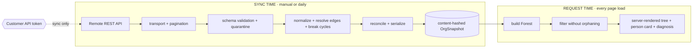
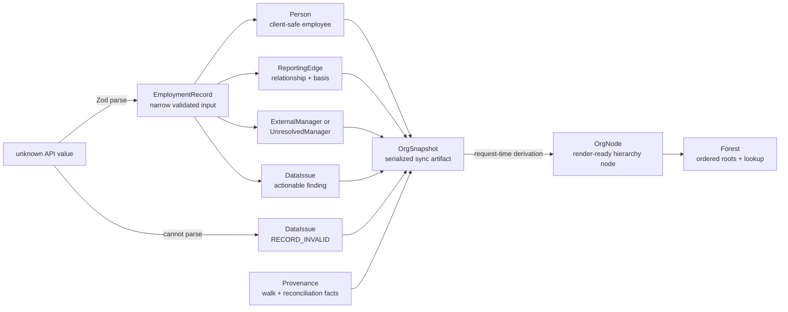

# Org Chart — System Design Review Sheet

## 1. System boundary

**Goal:** turn Remote employment data into a trustworthy, publicly accessible reporting hierarchy while keeping credentials and Remote API traffic outside the application request path.

**Trust boundary:** the deployed application reads the committed snapshot. It performs no runtime Remote API call and holds no Remote credential.

## 2. Remote API read path

| Order | Contract | Why it exists |
|---:|---|---|
| 1 | `GET /v1/identity/current` | Resolve company identity and fail early on invalid authentication. |
| 2 | `GET /v1/employments?page=1&page_size=1` | Obtain an independent `total_count`; the returned employment is discarded. |
| 3 | `GET /v1/employments/bulk` to `next_cursor === null` | Retrieve full employment records, including `manager_employment_id`, in cursor pages. |

## 3. Core entities are separate concepts

`EmploymentRecord` is the domain input, `Person` is the safe employee projection, `ReportingEdge` records how a relationship was determined, `OrgSnapshot` is the on-disk data contract, and `OrgNode` exists only after request-time forest construction.

## 4. Load-bearing invariants

> ### Cross-endpoint count identity
> `listTotalCount === recordCount - deletedCount`
>
> A mismatch becomes the high-severity, sync-scoped `COUNT_MISMATCH` finding.

> ### Conservation law: nothing silently disappears
> `recordCount === people.length + quarantinedCount`
>
> Synthetic managers are excluded because they are not walked employment records. A violation is a pipeline defect and prevents publication.

| Additional publication guard | Required behavior |
|---|---|
| Cursor completeness | Reach a terminal cursor; reject repeated cursors, non-progressing pages, and excessive page counts. |
| Employment identity | Refuse to write if an employment ID appears more than once. |
| Referential integrity | Every reporting edge must target a placed person, a root, or the synthetic-ID namespace. |
| Schema-drift boundary | Refuse to write when more than 20% of walked records fail full validation. |
| Deterministic artifact | Canonically order collections; unchanged content hash leaves the snapshot and paired log untouched. |

## 5. Decision ledger

| Decision | What it buys | Accepted cost | Revisit when |
|---|---|---|---|
| Direct REST with a Customer API token | Deterministic unattended synchronization | This integration owns transport, pagination, retries, and reconciliation | The product becomes an interactive, user-authorized workflow |
| Scheduled snapshot, not request-time fetching | No runtime credential or Remote availability dependency | Up to one schedule interval of staleness | Near-real-time freshness becomes a requirement |
| Bulk records plus a list-endpoint control total | Manager linkage and an independent completeness check | One additional API request | Bulk supplies a trustworthy independent total or a better contract |
| Static artifact, no database or webhook receiver | Small operational surface and reproducible output | No event history or real-time update path | Durable history, deduped events, multi-tenancy, or write workflows are required |

## 6. Evidence map

| Claim | Reviewer-verifiable evidence |
|---|---|
| Remote response shapes match the parser | Redacted captured responses + `schemas.contract.test.ts` |
| Every manager case has an explicit outcome | `resolve-edges.ts`, `break-cycles.ts`, their fixtures and tests |
| No walked record is silently lost | `reconcile.ts`, conservation tests, and the Data diagnosis counters |
| Re-syncing identical data is a no-op | `snapshot-writer.ts` determinism tests + content-hash comparison in `sync.ts` |
| Edge cases are visible in the product | Deployed `?source=fixture&review=open` view |

---

**Repository anchors:** [`README.md`](../../../README.md) · [`scripts/sync.ts`](../../../scripts/sync.ts) · [`src/domain/types.ts`](../../../src/domain/types.ts) · [`src/domain/resolve-edges.ts`](../../../src/domain/resolve-edges.ts) · [`src/domain/reconcile.ts`](../../../src/domain/reconcile.ts) · [`src/lib/snapshot-writer.ts`](../../../src/lib/snapshot-writer.ts)
